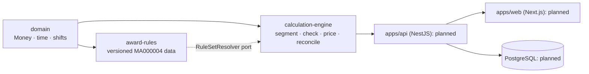

# WageGuard

**Understand your pay. Verify every dollar.**

WageGuard is an independent Australian payroll verification tool. It calculates the award minimum gross pay for supported shifts using deterministic, versioned rules taken from the official award text. It then compares that figure with a payslip and explains every dollar, or says plainly when a situation is outside what it can verify.

> **Status: in development.** The calculation engine, rule system, reconciliation, tests and engine benchmarks are implemented and verified. The API, database, authentication and web UI are not built yet; see [the checklist](docs/implementation-checklist.md). WageGuard is informational and is not legal advice.

## What works today

- **Calculation engine** (`packages/calculation-engine`). Validates timesheet input, selects the rule set in force for the pay period, splits shifts at local midnight and rule boundaries (DST-aware), prices ordinary and penalty hours with exact decimal arithmetic, and returns a full explanation trace.
- **Reconciliation.** Compares a calculation with a payslip and produces `MATCHED`, `POTENTIAL_UNDERPAYMENT`, `POTENTIAL_OVERPAYMENT`, `REVIEW_REQUIRED`, `UNSUPPORTED_SCENARIO` or `INCOMPLETE_DATA` findings, each with clause references, evidence pointers and a next step.
- **Versioned award rules** (`packages/award-rules`). MA000004 rates transcribed from the Fair Work Commission's consolidated award (amendments to 1 July 2026), with verbatim clause excerpts. Published rule sets are immutable, enforced by content fingerprints.
- **Evidence tooling.** Golden correctness scenarios, reproducible benchmarks, and a resume-evidence generator that only reports measured values.

## Architecture



The pure packages have no framework or I/O dependencies ([ADR 0001](docs/adr/0001-modular-monolith-hexagonal.md)). More detail: [architecture](docs/architecture.md) and [rules engine](docs/rules-engine.md).

## Supported scenarios

General Retail Industry Award 2020 (MA000004), **Retail Employee Level 1**, **adult casual or part-time non-shiftworkers**, ordinary hours within the span of hours, pay periods starting on or after **1 July 2026**.

| Hours                 | Part-time | Casual (loading included) |
| --------------------- | --------- | ------------------------- |
| Mon-Fri 7 am to 6 pm  | $27.81    | $34.76                    |
| Mon-Fri 6 pm to 9 pm  | $34.76    | $41.72                    |
| Saturday 7 am to 6 pm | $34.76    | $41.72                    |
| Sunday 9 am to 6 pm   | $41.72    | $48.67                    |

**Not calculated** (returned as `REVIEW_REQUIRED` or `UNSUPPORTED_SCENARIO`): overtime, public holidays, minimum-engagement top-ups, breaks under 12 hours between work days, work outside the span of hours, full-time, juniors, shiftworkers, enterprise agreements, other classifications and awards, allowances and leave. See [known limitations](docs/known-limitations.md).

## Measured results

All measurements are synthetic, from one developer workstation (Intel i7-13650HX, Windows 11, Node 24.22.1). The methodology and raw records are in [docs/performance.md](docs/performance.md) and `benchmarks/results/`.

| Measure                                                                              | Result                                                                          | Evidence                                                         |
| ------------------------------------------------------------------------------------ | ------------------------------------------------------------------------------- | ---------------------------------------------------------------- |
| Engine throughput, 10,000 synthetic shifts (median of 10 repetitions)                | 32,588 shifts/s (commit `4b05512`; range 32,358–34,453 across non-outlier runs) | `benchmarks/results/engine-2026-10-22T12-01-59-466Z-3bf2ea.json` |
| Runtime reduction from profiling-led optimisation (same workload, identical outputs) | 85.3% (2,088 ms → 307 ms)                                                       | [ADR 0007](docs/adr/0007-offset-table-optimisation.md)           |
| Golden scenarios (10 hand-derived reference calculations + 11 correct refusals)      | 21 / 21                                                                         | `benchmarks/results/correctness-*.json`                          |
| Automated tests (unit, property-based, golden)                                       | 217 passing                                                                     | `benchmarks/test-reports/`                                       |
| Calculation engine coverage                                                          | 98.6% lines, 93.1% branches                                                     | Benchmark D record                                               |

The golden expectations are derived from the award's published Schedule B rates and **have not been reviewed by a payroll professional**. These figures show agreement on a small, defined scenario set, not legal accuracy.

## Getting started

Requirements: Node.js 24, pnpm 10 (`npm i -g pnpm@10`). Docker is needed later for PostgreSQL and Redis.

```bash
pnpm install
pnpm build
pnpm test             # unit + property + golden tests
pnpm test:coverage    # with 90% coverage gates
pnpm lint && pnpm typecheck && pnpm format:check
```

Benchmarks and evidence:

```bash
BENCHMARK_LABEL=optimised-local pnpm benchmark:engine
pnpm test:coverage && pnpm benchmark:correctness
pnpm benchmark:report       # benchmarks/reports/summary.md
pnpm resume:metrics         # docs/resume-evidence/
```

`docker compose up -d` starts PostgreSQL and Redis for the upcoming API (see `.env.example`). There are no demo credentials yet, because authentication is not implemented.

## Documentation

[Architecture](docs/architecture.md) · [Rules engine](docs/rules-engine.md) · [Award sources](docs/award-sources.md) · [Testing strategy](docs/testing-strategy.md) · [Performance](docs/performance.md) · [Security](docs/security.md) · [Known limitations](docs/known-limitations.md) · [ADRs](docs/adr/) · [Checklist](docs/implementation-checklist.md)

## Licence

Copyright (c) 2026 ijfabi. All rights reserved. The code is published for viewing and evaluation only; see [LICENSE](LICENSE).

## Roadmap

1. **Phase 2.** PostgreSQL and Prisma persistence, NestJS REST API with OpenAPI, authentication, object-level authorisation, immutable audit snapshots, idempotency keys, Testcontainers integration tests.
2. **Phase 3.** Next.js UI: employment setup, shift entry, CSV import, payslip entry, audit dashboard and explanations, Playwright E2E.
3. **Phase 4.** PDF reports, OpenTelemetry, security tests, container scanning.
4. **Phase 5.** API, database and reliability benchmarks (B, C, E).
5. **Later.** Public holiday calendar, overtime, further classifications, a human-reviewed golden set and a Pay Calculator cross-check.
