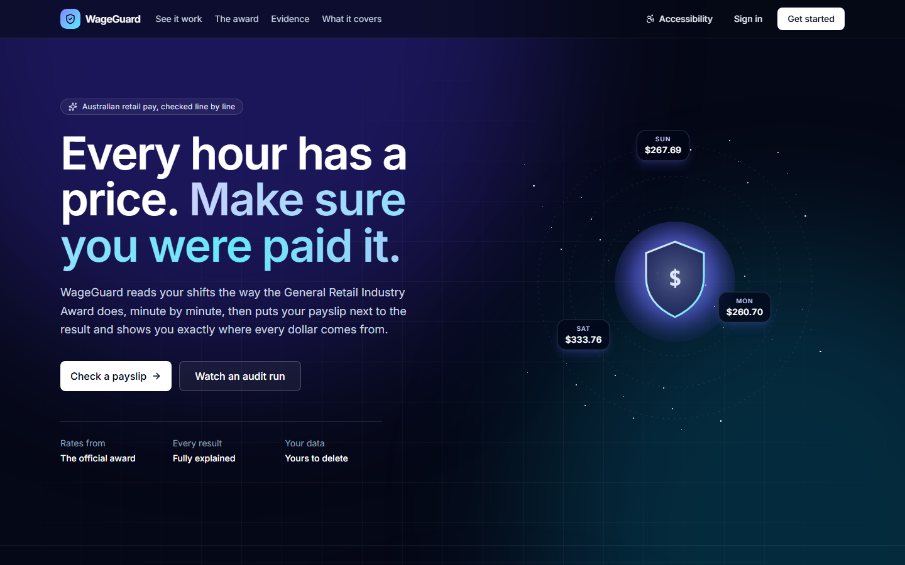
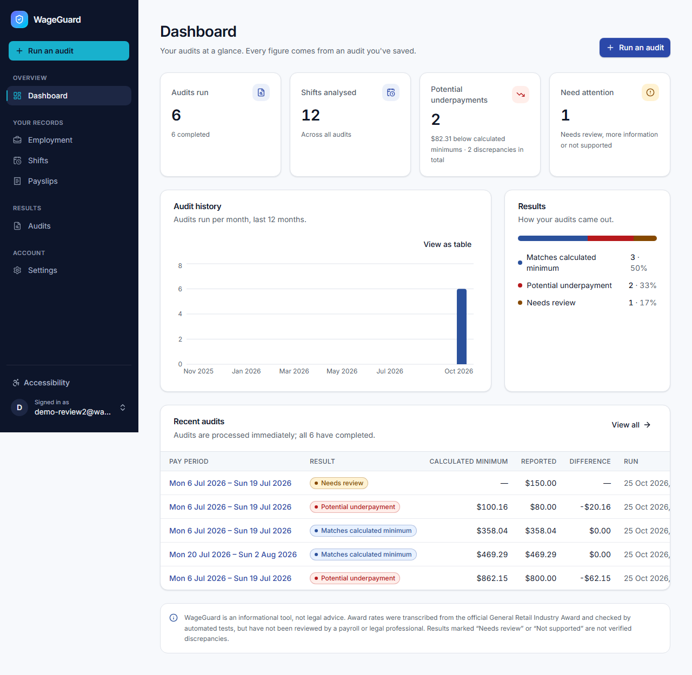
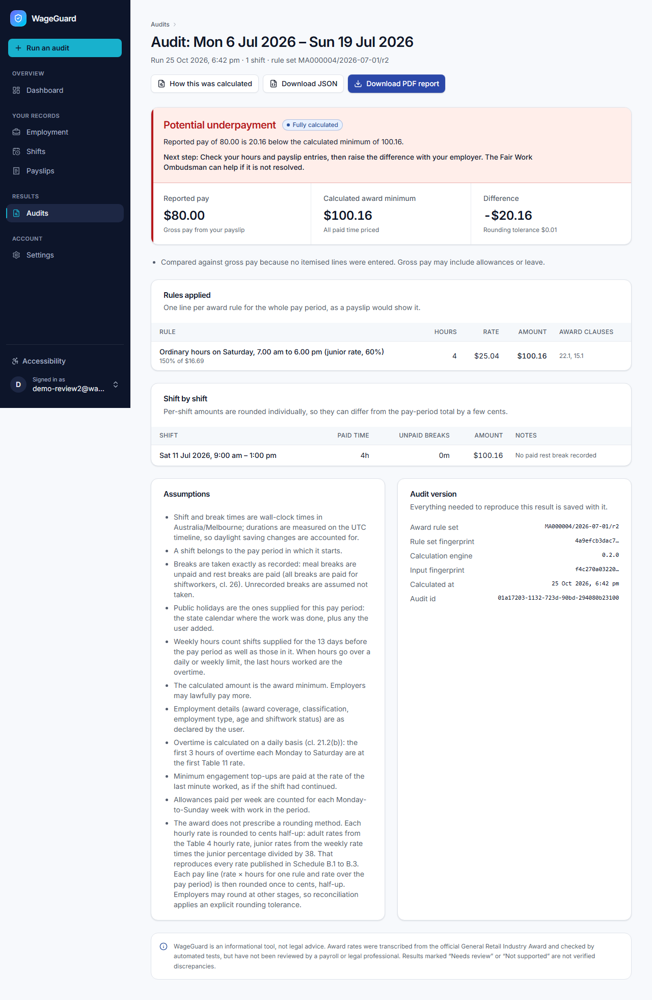
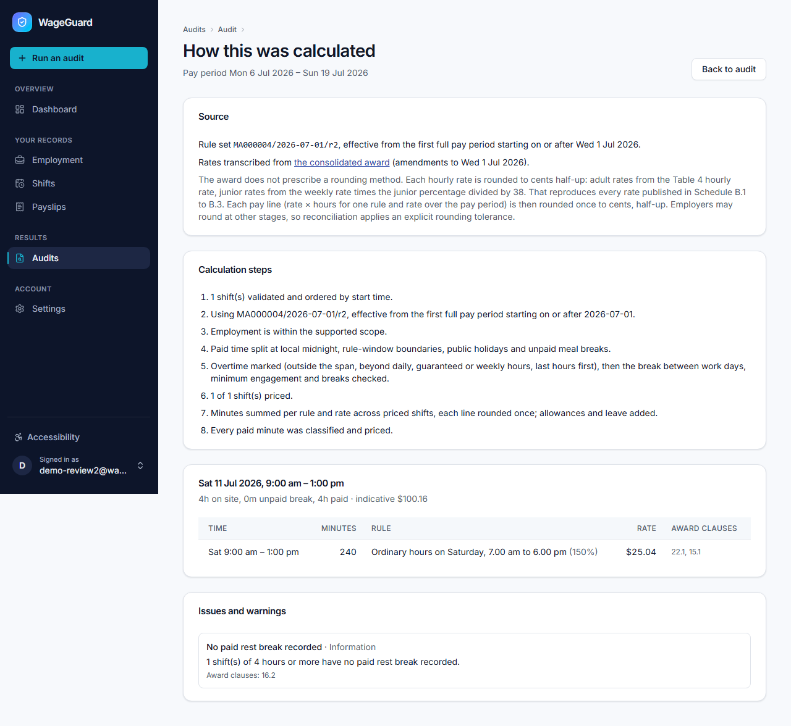
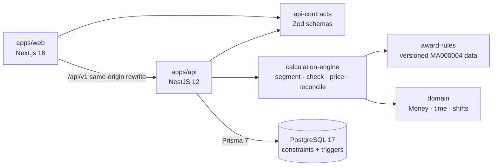

# WageGuard

**Understand your pay. Verify every dollar.**

WageGuard checks Australian retail pay. You enter your shifts and your payslip, and it works out the minimum the award requires for those shifts, compares that with what you were paid, and shows the working line by line. When a situation is outside what it can calculate, it says so instead of guessing.

The rules are taken from the official award text and are versioned and deterministic. There is no AI anywhere in the calculation.

> **Status:** a finished portfolio project. Everything listed under "What works" is built and tested, and [docs/demo.md](docs/demo.md) walks through it end to end. WageGuard is informational only and is not legal advice.





| Audit with a potential underpayment                         | How it was calculated                                                       |
| ----------------------------------------------------------- | --------------------------------------------------------------------------- |
|  |  |

The screenshots come from a seeded demo account with made-up data.

## What works

The web app (`apps/web`, Next.js 16) covers the whole flow: create an account and confirm it from the emailed link, add a job, enter shifts by hand or import them from CSV, enter a payslip, and run an audit. The audit form lists the public holidays for your state in that pay period and takes leave, allowance claims and written changes to part-time hours. Each audit has a detail page, a full explanation of the calculation, and a downloadable evidence report as PDF or JSON. The dashboard shows your audit history. Settings cover password changes, two-step sign-in with an authenticator app, signing out other devices, and deleting your account and all of its data. The homepage explains the product with an animated sample audit and quotes taken word for word from the award, and every page has an accessibility panel for theme, text size, motion and contrast ([ACCESSIBILITY.md](ACCESSIBILITY.md)).

The API (`apps/api`) is NestJS 12 with Prisma 7 and PostgreSQL 17. It uses cookie sessions with argon2id password hashing and checks ownership on every object. Sign-up never reveals whether an address already has an account, password reset works through single-use emailed links, and two-step sign-in uses TOTP with encrypted secrets and recovery codes. Rate limits are shared across instances through PostgreSQL. The database enforces ownership as well, with constraints and triggers. Audit creation is idempotent for 24 hours, so a retried request never creates a second audit. Completed audits can't be changed. There's an OpenAPI 3.1 document, and optional OpenTelemetry tracing that keeps pay data and identities out of the telemetry.

The calculation engine (`packages/calculation-engine`) picks the rule set in force for the pay period, splits each shift at midnight and at every rate boundary (daylight saving included), and prices the time with exact decimal arithmetic. It returns the full working along with the result, then compares the total with the payslip.

The award rules (`packages/award-rules`) are the General Retail Industry Award rates as published by the Fair Work Commission, with amendments to 1 July 2026, and the relevant clauses quoted word for word. A published rule set can't be edited: each one is fingerprinted, and CI fails if a fingerprint changes. Corrections and additions come as a new revision, and pay periods use the newest one. The package also holds the state and territory public holidays for 2026 and 2027.

## Technology

| Area        | Tools                                                                                                      |
| ----------- | ---------------------------------------------------------------------------------------------------------- |
| Web app     | Next.js 16, React 19, TypeScript, Tailwind CSS 4, shadcn/ui, TanStack Query, React Hook Form, Recharts     |
| API         | NestJS 12, Prisma 7, PostgreSQL 17, Zod 4, argon2id sessions, pdfkit, OpenTelemetry                        |
| Calculation | Plain TypeScript, decimal.js, Luxon (time-zone offsets only)                                               |
| Testing     | Vitest, fast-check, Testcontainers, Supertest, Playwright, axe-core, k6                                    |
| Delivery    | pnpm workspaces, Docker Compose, GitHub Actions, Trivy, gitleaks, Terraform (AWS and Azure, never applied) |

## Architecture



The calculation packages are plain TypeScript with no framework or I/O, which keeps them easy to test ([ADR 0001](docs/adr/0001-modular-monolith-hexagonal.md)). The [architecture notes](docs/architecture.md) go into more detail, along with the [rules engine](docs/rules-engine.md), [API](docs/api.md) and [data model](docs/data-model.md) docs.

## What it can and can't calculate

WageGuard covers one award: the General Retail Industry Award 2020 (MA000004), for pay periods starting on or after 1 July 2026. Rule set `MA000004/2026-07-01/r2` prices Retail Employee Levels 1 to 8, full-time, part-time and casual, adult and junior rates, ordinary and penalty hours, overtime, public holidays, minimum engagement, short breaks between work days, the longer spans for newsagencies, video shops and late-trading stores, shiftwork, allowances and paid leave. For a Level 1 adult:

| Hours                 | Full-time and part-time | Casual (loading included) |
| --------------------- | ----------------------- | ------------------------- |
| Mon-Fri 7 am to 6 pm  | $27.81                  | $34.76                    |
| Mon-Fri 6 pm to 9 pm  | $34.76                  | $41.72                    |
| Saturday 7 am to 6 pm | $34.76                  | $41.72                    |
| Sunday 9 am to 6 pm   | $41.72                  | $48.67                    |
| Public holiday        | $62.57                  | $69.53                    |

It doesn't calculate apprentice, trainee or supported wage rates, baking production shiftwork, higher duties, recall, travelling time, time off instead of overtime, or enterprise agreements. When an audit touches any of those, or an answer you gave was "not sure", the result is marked "needs review" or "not supported" and the affected hours aren't priced. [Known limitations](docs/known-limitations.md) has the full list.

## Measured results

Every number here comes from a saved benchmark record. They are synthetic runs on one laptop (Intel i7-13650HX, Windows 11, Node 24.22.1), so treat them as relative measurements, not production capacity. The methods and raw data are in [docs/performance.md](docs/performance.md) and `benchmarks/results/`. The database, API and reliability rows were recorded before rule set r2 and the account security changes, and haven't been repeated since. The API run in particular predates the rate-limit counters moving into PostgreSQL.

| What was measured                                                                    | Result                                                                                     |
| ------------------------------------------------------------------------------------ | ------------------------------------------------------------------------------------------ |
| Calculation engine (rule set r2), 10,000 synthetic shifts                            | 19,515 shifts/s median of 3 runs (15,530–20,266). r1, which priced far less, ran at 32,588 |
| Engine runtime after profiling and optimising time-zone lookups (r1)                 | 85.3% faster on the same workload (2,088 ms → 307 ms), identical output                    |
| Audit history page with 50,000 audits in the database                                | 6.06 ms → 1.36 ms median (−77.6%) after it stopped loading unused JSON snapshots           |
| Dashboard with 50,000 audits                                                         | 23.5 ms → 8.9 ms median (−62.3%) after an index change removed two full-table scans        |
| Importing a 14-row CSV                                                               | 71.7 ms → 15.5 ms (−78.5%), 60 SQL statements → 6                                          |
| API throughput at 50 concurrent clients (k6, before shared rate limits)              | 307 → 475 requests/s (+54.9%), p95 443 ms → 312 ms, 0% errors                              |
| Audit submissions with the API killed mid-load, then with the database down for 10 s | 14,999 of 14,999 completed, no duplicates, no lost or inconsistent records                 |
| Golden scenarios (rule set r2)                                                       | 29 of 29: 23 hand-worked reference calculations and 6 correct refusals                     |
| Automated tests                                                                      | 455 passing, plus 17 Playwright end-to-end tests                                           |
| Calculation engine coverage                                                          | 98.2% of lines, 91.7% of branches                                                          |

The golden scenarios were worked out by hand from the award's published rates, and nobody with payroll qualifications has reviewed them yet. They show the engine agrees with those calculations on a small, defined set of cases. They don't prove legal accuracy.

## Running it

You'll need Node.js 24, pnpm 10 (`npm i -g pnpm@10`) and Docker.

To run everything in containers:

```bash
docker compose up --build
# Web app:  http://localhost:3000
# API:      http://localhost:3001/api/v1/health  (OpenAPI at /api/v1/openapi.json)
# Email:    http://localhost:8025  (Mailpit catches sign-up and password reset emails)
```

Nothing is sent to real inboxes locally. After signing up, open the confirmation email in Mailpit.

Or follow the [walkthrough](docs/demo.md), which shows every step with screenshots.

There's no demo password in the repository. Pick your own and seed a synthetic account, confirmed through Mailpit, with six audits: a match, an underpayment, a fortnight with overtime, a part-time job, a 17-year-old on junior rates, and one that needs review:

```bash
DEMO_PASSWORD='choose-at-least-12-chars' pnpm --filter @wageguard/api seed:demo
# then sign in at http://localhost:3000 as demo@wageguard.example
```

For development and testing:

```bash
pnpm install
pnpm build && pnpm --filter @wageguard/web build
pnpm test                               # unit, property, golden and API tests (needs Docker)
pnpm --filter @wageguard/web e2e        # Playwright and axe accessibility checks (needs PostgreSQL)
pnpm lint && pnpm typecheck && pnpm format:check
```

Benchmarks write their raw results to `benchmarks/results/`:

```bash
pnpm benchmark:engine        # A: calculation engine
pnpm benchmark:api           # B: API under load (k6, Docker)
pnpm benchmark:database      # C: database queries (run pnpm build first)
pnpm benchmark:reliability   # E: failure injection (Docker)
pnpm benchmark:report        # benchmarks/reports/summary.md
pnpm resume:metrics          # docs/resume-evidence/
```

## Documentation

[Demo](docs/demo.md) · [Information architecture](docs/information-architecture.md) · [Architecture](docs/architecture.md) · [Rules engine](docs/rules-engine.md) · [API](docs/api.md) · [Data model](docs/data-model.md) · [Award sources](docs/award-sources.md) · [Testing](docs/testing-strategy.md) · [Performance](docs/performance.md) · [Security](docs/security.md) · [Observability](docs/observability.md) · [Infrastructure](docs/infrastructure.md) · [Deployment](docs/deployment.md) · [Accessibility](ACCESSIBILITY.md) · [Known limitations](docs/known-limitations.md) · [Decision records](docs/adr/) · [Checklist](docs/implementation-checklist.md) · [Acceptance](docs/acceptance.md)

## Deploying

`docker compose up --build` runs everything locally. `infra/aws` and `infra/azure` hold optional cloud deployments in Terraform (ECS Fargate and RDS on AWS, Container Apps and PostgreSQL Flexible Server on Azure). CI validates both, but neither has ever been applied. [Infrastructure](docs/infrastructure.md) has the architecture diagrams for both clouds, the Terraform commands, and a proposed production design. [Deployment](docs/deployment.md) covers both, along with the [backup and recovery](docs/runbooks/backup-and-recovery.md) and [incident response](docs/runbooks/incident-response.md) runbooks.

## What's next

All six planned phases are done, and [docs/acceptance.md](docs/acceptance.md) checks the result against the original acceptance criteria. Since then, rule set r2 has added overtime, public holidays with a state calendar, all eight classifications, full-time, junior and shiftwork rates, allowances and leave, and the app has gained email verification, password reset and two-step sign-in. Still open: a golden set reviewed by a payroll professional, a cross-check against the Fair Work Pay Calculator, repeating the API and database benchmarks on the current code, apprentice and trainee rates, and a tagged PDF.

## Licence

Copyright (c) 2026 ijfabi. All rights reserved. The code is published so it can be read and evaluated, not reused. See [LICENSE](LICENSE).
