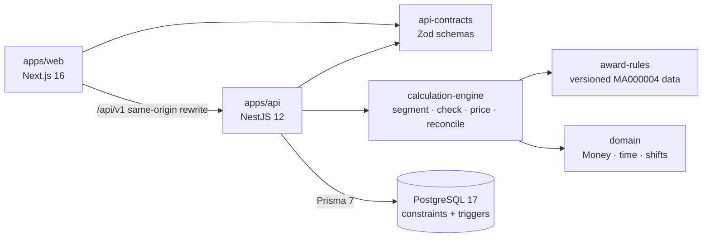

# WageGuard

**Understand your pay. Verify every dollar.**

WageGuard is an independent Australian payroll verification tool. It calculates the award minimum gross pay for supported shifts using deterministic, versioned rules taken from the official award text. It then compares that figure with a payslip and explains every dollar, or says plainly when a situation is outside what it can verify.

> **Status: in development.** The calculation engine, the REST API with PostgreSQL and authentication, the web app, PDF evidence reports and opt-in OpenTelemetry are implemented and tested. The API, database and reliability benchmarks and a cloud deployment are still to come; see [the checklist](docs/implementation-checklist.md). WageGuard is informational and is not legal advice.


| Audit with a potential underpayment                         | How it was calculated                                                       |
| ----------------------------------------------------------- | --------------------------------------------------------------------------- |
|  |  |

Screenshots show a seeded **synthetic** demonstration account.

## What works today

- **Web app** (`apps/web`, Next.js 16):
  - sign up and sign in;
  - employment profiles;
  - shifts, entered one at a time or imported from CSV;
  - payslip entry;
  - audits, with a dashboard, audit history and audit detail;
  - a full calculation explanation, and the evidence report as a printable PDF or JSON;
  - account deletion.
- **REST API** (`apps/api`, NestJS 12, Prisma 7, PostgreSQL 17):
  - cookie sessions with argon2id password hashing;
  - per-user access checks, also enforced by database constraints;
  - idempotent audit creation (no duplicates from retries);
  - completed audits that can't be changed;
  - an OpenAPI 3.1 document;
  - opt-in OpenTelemetry traces and metrics with no pay data or identities in them ([observability](docs/observability.md)).
- **Calculation engine** (`packages/calculation-engine`):
  - selects the rule set in force for the pay period;
  - splits shifts at local midnight and at rule boundaries, accounting for daylight saving;
  - prices ordinary and penalty hours with exact decimal arithmetic;
  - returns a full explanation trace;
  - reconciles the result against the payslip.
- **Versioned award rules** (`packages/award-rules`): MA000004 rates transcribed from the Fair Work Commission's consolidated award (amendments to 1 July 2026), with verbatim clause excerpts. Published rule sets are immutable, enforced by content fingerprints.
- **Security hardening:** a per-request nonce Content Security Policy (no inline scripts), object-level authorisation tests on every route, and container, dependency and secret scanning in CI.
- **Evidence tooling:** golden correctness scenarios, reproducible benchmarks, and a resume-evidence generator that only reports measured values.

## Architecture



The pure packages have no framework or I/O dependencies ([ADR 0001](docs/adr/0001-modular-monolith-hexagonal.md)). More detail: [architecture](docs/architecture.md), [rules engine](docs/rules-engine.md), [API](docs/api.md), [data model](docs/data-model.md), [frontend](docs/adr/0012-web-frontend-architecture.md).

## Supported scenarios

General Retail Industry Award 2020 (MA000004), **Retail Employee Level 1**, **adult casual or part-time non-shiftworkers**, ordinary hours within the span of hours, pay periods starting on or after **1 July 2026**.

| Hours                 | Part-time | Casual (loading included) |
| --------------------- | --------- | ------------------------- |
| Mon-Fri 7 am to 6 pm  | $27.81    | $34.76                    |
| Mon-Fri 6 pm to 9 pm  | $34.76    | $41.72                    |
| Saturday 7 am to 6 pm | $34.76    | $41.72                    |
| Sunday 9 am to 6 pm   | $41.72    | $48.67                    |

**Not calculated** (returned as `REVIEW_REQUIRED` or `UNSUPPORTED_SCENARIO`, never guessed):

- overtime and public holidays;
- minimum-engagement top-ups;
- breaks of less than 12 hours between work days;
- work outside the span of ordinary hours;
- full-time, junior and shiftwork employment;
- enterprise agreements, other classifications and other awards;
- allowances and leave.

See [known limitations](docs/known-limitations.md).

## Measured results

All measurements are synthetic, from one developer workstation (Intel i7-13650HX, Windows 11, Node 24.22.1). The methodology and raw records are in [docs/performance.md](docs/performance.md) and `benchmarks/results/`.

| Measure                                                                                 | Result                                                                          | Evidence                                                         |
| --------------------------------------------------------------------------------------- | ------------------------------------------------------------------------------- | ---------------------------------------------------------------- |
| Engine throughput, 10,000 synthetic shifts (median of 10 repetitions)                   | 32,588 shifts/s (commit `4b05512`; range 32,358–34,453 across non-outlier runs) | `benchmarks/results/engine-2026-10-22T12-01-59-466Z-3bf2ea.json` |
| Runtime reduction from profiling-led optimisation (same workload, identical outputs)    | 85.3% (2,088 ms → 307 ms)                                                       | [ADR 0007](docs/adr/0007-offset-table-optimisation.md)           |
| Golden scenarios (10 hand-derived reference calculations + 11 correct refusals)         | 21 / 21                                                                         | `benchmarks/results/correctness-*.json`                          |
| Automated tests (unit, property-based, golden, API integration on real PostgreSQL, web) | 334 passing, plus 10 Playwright E2E                                             | `benchmarks/test-reports/`, CI                                   |
| Calculation engine coverage                                                             | 98.6% lines, 93.1% branches                                                     | Benchmark D record                                               |

The golden expectations are derived from the award's published Schedule B rates and **have not been reviewed by a payroll professional**. These figures show agreement on a small, defined scenario set, not legal accuracy.

## Getting started

Requirements: Node.js 24, pnpm 10 (`npm i -g pnpm@10`), Docker.

**Run everything in containers:**

```bash
docker compose up --build
# Web app:  http://localhost:3000
# API:      http://localhost:3001/api/v1/health  (OpenAPI: /api/v1/openapi.json)
```

**Demo account.** No password is stored in the repository. Choose your own, then seed a synthetic account with four audits (a match, an underpayment, a needs-review case and a part-time job):

```bash
DEMO_PASSWORD='choose-at-least-12-chars' pnpm --filter @wageguard/api seed:demo
# then sign in at http://localhost:3000 as demo@wageguard.example
```

**Develop and test:**

```bash
pnpm install
pnpm build && pnpm --filter @wageguard/web build
pnpm test                               # unit, property, golden and API integration tests (Docker required)
pnpm --filter @wageguard/web e2e        # Playwright + axe accessibility checks (needs PostgreSQL)
pnpm lint && pnpm typecheck && pnpm format:check
```

**Benchmarks and evidence:**

```bash
BENCHMARK_LABEL=optimised-local pnpm benchmark:engine
pnpm test:coverage && pnpm benchmark:correctness
pnpm benchmark:report       # benchmarks/reports/summary.md
pnpm resume:metrics         # docs/resume-evidence/
```

## Documentation

[Architecture](docs/architecture.md) · [Rules engine](docs/rules-engine.md) · [API](docs/api.md) · [Data model](docs/data-model.md) · [Award sources](docs/award-sources.md) · [Testing strategy](docs/testing-strategy.md) · [Performance](docs/performance.md) · [Security](docs/security.md) · [Observability](docs/observability.md) · [Deployment](docs/deployment.md) · [Known limitations](docs/known-limitations.md) · [ADRs](docs/adr/) · [Checklist](docs/implementation-checklist.md)

## Licence

Copyright (c) 2026 ijfabi. All rights reserved. The code is published for viewing and evaluation only; see [LICENSE](LICENSE).

## Roadmap

1. **Phases 0–4 (done).** Engine, rules, API, persistence, authentication, web app, end-to-end and accessibility tests, PDF reports, OpenTelemetry, nonce-based CSP.
2. **Phase 5.** API, database and reliability benchmarks (B, C, E).
3. **Phase 6.** Final review and an optional cloud deployment design (never applied without approval).
4. **Later.** Unicode and tagged PDF, a public holiday calendar, overtime, further classifications, a human-reviewed golden set and a Pay Calculator cross-check.
