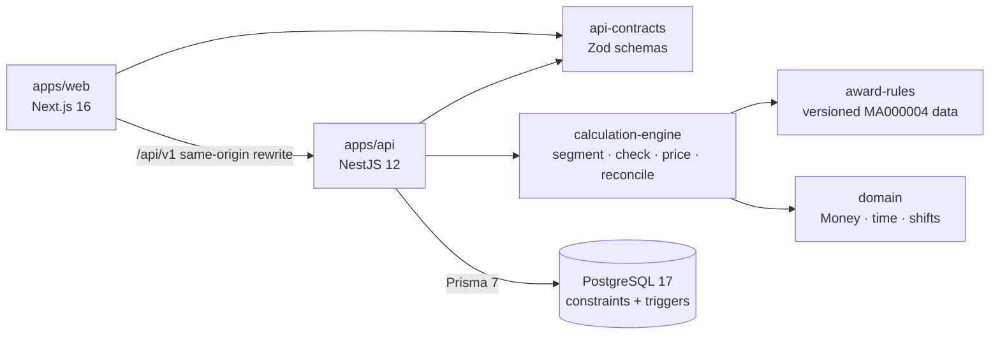

# WageGuard

**Understand your pay. Verify every dollar.**

WageGuard checks Australian retail pay. You enter your shifts and your payslip, and it works out the minimum the award requires for those shifts, compares that with what you were paid, and shows the working line by line. When a situation is outside what it can calculate, it says so instead of guessing.

The rules are taken from the official award text and are versioned and deterministic. There is no AI anywhere in the calculation.

> **Status:** a finished portfolio project. Everything listed under "What works" is built and tested, and [docs/demo.md](docs/demo.md) walks through it end to end. WageGuard is informational only and is not legal advice.


| Audit with a potential underpayment                         | How it was calculated                                                       |
| ----------------------------------------------------------- | --------------------------------------------------------------------------- |
|  |  |

The screenshots come from a seeded demo account with made-up data.

## What works

The web app (`apps/web`, Next.js 16) covers the whole flow: create an account, add a job, enter shifts by hand or import them from CSV, enter a payslip, and run an audit. Each audit has a detail page, a full explanation of the calculation, and a downloadable evidence report as PDF or JSON. The dashboard shows your audit history, and you can delete your account and all of its data from settings.

The API (`apps/api`) is NestJS 12 with Prisma 7 and PostgreSQL 17. It uses cookie sessions with argon2id password hashing and checks ownership on every object. The database enforces ownership as well, with constraints and triggers. Audit creation is idempotent, so a retried request never creates a second audit. Completed audits can't be changed. There's an OpenAPI 3.1 document, and optional OpenTelemetry tracing that keeps pay data and identities out of the telemetry.

The calculation engine (`packages/calculation-engine`) picks the rule set in force for the pay period, splits each shift at midnight and at every rate boundary (daylight saving included), and prices the time with exact decimal arithmetic. It returns the full working along with the result, then compares the total with the payslip.

The award rules (`packages/award-rules`) are the General Retail Industry Award rates as published by the Fair Work Commission, with amendments to 1 July 2026, and the relevant clauses quoted word for word. A published rule set can't be edited: each one is fingerprinted, and CI fails if a fingerprint changes.

## Technology

| Area        | Tools                                                                                                  |
| ----------- | ------------------------------------------------------------------------------------------------------ |
| Web app     | Next.js 16, React 19, TypeScript, Tailwind CSS 4, shadcn/ui, TanStack Query, React Hook Form, Recharts |
| API         | NestJS 12, Prisma 7, PostgreSQL 17, Zod 4, argon2id sessions, pdfkit, OpenTelemetry                    |
| Calculation | Plain TypeScript, decimal.js, Luxon (time-zone offsets only)                                           |
| Testing     | Vitest, fast-check, Testcontainers, Supertest, Playwright, axe-core, k6                                |
| Delivery    | pnpm workspaces, Docker Compose, GitHub Actions, Trivy, gitleaks, Terraform (AWS, never applied)       |

## Architecture



The calculation packages are plain TypeScript with no framework or I/O, which keeps them easy to test ([ADR 0001](docs/adr/0001-modular-monolith-hexagonal.md)). The [architecture notes](docs/architecture.md) go into more detail, along with the [rules engine](docs/rules-engine.md), [API](docs/api.md) and [data model](docs/data-model.md) docs.

## What it can and can't calculate

WageGuard covers one slice of one award: the General Retail Industry Award 2020 (MA000004), Retail Employee Level 1, adults on casual or part-time contracts who aren't shiftworkers, working ordinary hours, in pay periods starting on or after 1 July 2026.

| Hours                 | Part-time | Casual (loading included) |
| --------------------- | --------- | ------------------------- |
| Mon-Fri 7 am to 6 pm  | $27.81    | $34.76                    |
| Mon-Fri 6 pm to 9 pm  | $34.76    | $41.72                    |
| Saturday 7 am to 6 pm | $34.76    | $41.72                    |
| Sunday 9 am to 6 pm   | $41.72    | $48.67                    |

It doesn't calculate overtime, public holidays, minimum-engagement top-ups, short breaks between shifts, work outside the span of ordinary hours, full-time, junior or shiftwork employment, enterprise agreements, other classifications or awards, allowances, or leave. When an audit touches any of those, the result is marked "needs review" or "not supported", and the affected hours aren't priced. [Known limitations](docs/known-limitations.md) has the full list.

## Measured results

Every number here comes from a saved benchmark record. They are synthetic runs on one laptop (Intel i7-13650HX, Windows 11, Node 24.22.1), so treat them as relative measurements, not production capacity. The methods and raw data are in [docs/performance.md](docs/performance.md) and `benchmarks/results/`.

| What was measured                                                                    | Result                                                                              |
| ------------------------------------------------------------------------------------ | ----------------------------------------------------------------------------------- |
| Calculation engine, 10,000 synthetic shifts                                          | 32,588 shifts/s median (32,358–34,453 across normal runs)                           |
| Engine runtime after profiling and optimising time-zone lookups                      | 85.3% faster on the same workload (2,088 ms → 307 ms), identical output             |
| Audit history page with 50,000 audits in the database                                | 6.06 ms → 1.36 ms median (−77.6%) after it stopped loading unused JSON snapshots    |
| Dashboard with 50,000 audits                                                         | 23.5 ms → 8.9 ms median (−62.3%) after an index change removed two full-table scans |
| Importing a 14-row CSV                                                               | 71.7 ms → 15.5 ms (−78.5%), 60 SQL statements → 6                                   |
| API throughput at 50 concurrent clients (k6, production image)                       | 307 → 475 requests/s (+54.9%), p95 443 ms → 312 ms, 0% errors                       |
| Audit submissions with the API killed mid-load, then with the database down for 10 s | 14,999 of 14,999 completed, no duplicates, no lost or inconsistent records          |
| Golden scenarios                                                                     | 21 of 21: 10 hand-worked reference calculations and 11 correct refusals             |
| Automated tests                                                                      | 346 passing, plus 10 Playwright end-to-end tests                                    |
| Calculation engine coverage                                                          | 98.6% of lines, 93.1% of branches                                                   |

The golden scenarios were worked out by hand from the award's published rates, and nobody with payroll qualifications has reviewed them yet. They show the engine agrees with those calculations on a small, defined set of cases. They don't prove legal accuracy.

## Running it

You'll need Node.js 24, pnpm 10 (`npm i -g pnpm@10`) and Docker.

To run everything in containers:

```bash
docker compose up --build
# Web app:  http://localhost:3000
# API:      http://localhost:3001/api/v1/health  (OpenAPI at /api/v1/openapi.json)
```

Or follow the [walkthrough](docs/demo.md), which shows every step with screenshots.

There's no demo password in the repository. Pick your own and seed a synthetic account with four audits (a match, an underpayment, one that needs review, and a part-time job):

```bash
DEMO_PASSWORD='choose-at-least-12-chars' pnpm --filter @wageguard/api seed:demo
# then sign in at http://localhost:3000 as demo@wageguard.example
```

For development and testing:

```bash
pnpm install
pnpm build && pnpm --filter @wageguard/web build
pnpm test                               # unit, property, golden and API tests (needs Docker)
pnpm --filter @wageguard/web e2e        # Playwright and axe accessibility checks (needs PostgreSQL)
pnpm lint && pnpm typecheck && pnpm format:check
```

Benchmarks write their raw results to `benchmarks/results/`:

```bash
pnpm benchmark:engine        # A: calculation engine
pnpm benchmark:api           # B: API under load (k6, Docker)
pnpm benchmark:database      # C: database queries (run pnpm build first)
pnpm benchmark:reliability   # E: failure injection (Docker)
pnpm benchmark:report        # benchmarks/reports/summary.md
pnpm resume:metrics          # docs/resume-evidence/
```

## Documentation

[Demo](docs/demo.md) · [Architecture](docs/architecture.md) · [Rules engine](docs/rules-engine.md) · [API](docs/api.md) · [Data model](docs/data-model.md) · [Award sources](docs/award-sources.md) · [Testing](docs/testing-strategy.md) · [Performance](docs/performance.md) · [Security](docs/security.md) · [Observability](docs/observability.md) · [Deployment](docs/deployment.md) · [Known limitations](docs/known-limitations.md) · [Decision records](docs/adr/) · [Checklist](docs/implementation-checklist.md) · [Acceptance](docs/acceptance.md)

## Deploying

`docker compose up --build` runs everything locally. `infra/aws` holds an optional AWS deployment in Terraform (load balancer, ECS Fargate, RDS PostgreSQL), which CI validates but which has never been applied. [Deployment](docs/deployment.md) covers both, along with the [backup and recovery](docs/runbooks/backup-and-recovery.md) and [incident response](docs/runbooks/incident-response.md) runbooks.

## What's next

All six planned phases are done, and [docs/acceptance.md](docs/acceptance.md) checks the result against the original acceptance criteria. Still open: a font that covers all characters in the PDF, a public holiday calendar, overtime, more classifications, a golden set reviewed by a payroll professional, and a cross-check against the Fair Work Pay Calculator.

## Licence

Copyright (c) 2026 ijfabi. All rights reserved. The code is published so it can be read and evaluated, not reused. See [LICENSE](LICENSE).
