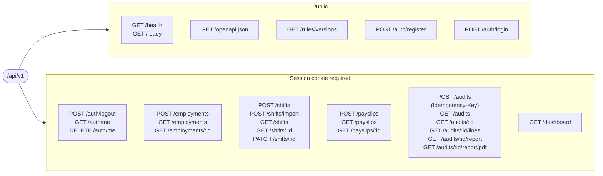
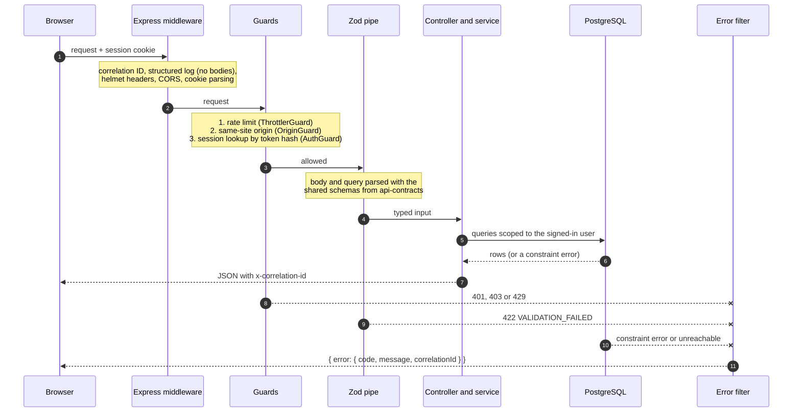

# REST API

All routes live under `/api/v1`. The full contract is the OpenAPI 3.1 document at `GET /api/v1/openapi.json`, which is generated from the Zod schemas in `packages/api-contracts`. The API uses the same schemas to validate requests ([ADR 0011](adr/0011-contract-first-api-and-database-integrity.md)). A test fails if a route is added without being documented. The API's integration tests run against a real PostgreSQL database.

## Signing in

`POST /auth/register` and `POST /auth/login` set a session cookie that is HTTP-only and `SameSite=Strict`. It's called `wg_session`, or `__Host-wg_session` when cookies are marked Secure. Every route needs that cookie except the public ones marked below.

Anything owned by another user returns `404`, exactly as if it didn't exist, so the API never confirms that someone else's record is there. State-changing requests from another site (a foreign `Origin` header, or `Sec-Fetch-Site: cross-site`) are refused with `403 FORBIDDEN_ORIGIN`. More detail is in [ADR 0009](adr/0009-authentication-and-sessions.md).

## Endpoints

| Method    | Path                               | Notes                                                                                                                                                                                                                    |
| --------- | ---------------------------------- | ------------------------------------------------------------------------------------------------------------------------------------------------------------------------------------------------------------------------ |
| POST      | `/auth/register`                   | Public, with a stricter rate limit. Passwords need at least 12 characters. 409 if the email is taken.                                                                                                                    |
| POST      | `/auth/login`                      | Public, with a stricter rate limit. The same 401 message for an unknown email and a wrong password.                                                                                                                      |
| POST      | `/auth/logout`                     | Ends the session on the server.                                                                                                                                                                                          |
| GET       | `/auth/me`                         | The current user.                                                                                                                                                                                                        |
| DELETE    | `/auth/me`                         | Takes `{ password }`. Deletes the account and everything in it, audits included.                                                                                                                                         |
| POST, GET | `/employments`, `/employments/:id` | `timeZone` must be an IANA zone such as `Australia/Sydney`.                                                                                                                                                              |
| POST      | `/shifts`                          | Times as they appear on the timesheet, plus breaks. Checked for times that don't exist or happen twice when daylight saving changes, and for breaks outside the shift. 409 `SHIFT_OVERLAP` if it overlaps another shift. |
| POST      | `/shifts/import?employmentId=`     | `Content-Type: text/csv`, up to 256 KiB and 500 rows, with the header `start,end,meal_start,meal_end`. Either every row is imported or none is, and errors name the line.                                                |
| GET       | `/shifts`                          | Filter by `employmentId`, `from` and `to`. Sort with `start_asc` or `start_desc`. Paginated.                                                                                                                             |
| GET       | `/shifts/:id`                      |                                                                                                                                                                                                                          |
| PATCH     | `/shifts/:id`                      | Replaces the times and breaks. Send the `version` you read: a stale one gets 409 `VERSION_CONFLICT`. The employment can't be changed.                                                                                    |
| POST, GET | `/payslips`, `/payslips/:id`       | Itemised lines must add up exactly to the gross pay.                                                                                                                                                                     |
| POST      | `/audits`                          | Requires an `Idempotency-Key` header. The pay period comes from the payslip. Returns 201 for a new audit, or 200 with `Idempotent-Replayed: true` for a repeat.                                                          |
| GET       | `/audits`                          | Filter by `findingStatus`. Sort with `created_desc` or `created_asc`. Paginated.                                                                                                                                         |
| GET       | `/audits/:id`                      | Summary, findings, notes, assumptions, the rule-set fingerprint and the input hash.                                                                                                                                      |
| GET       | `/audits/:id/lines`                | Pay lines and the shift-by-shift breakdown.                                                                                                                                                                              |
| GET       | `/audits/:id/report`               | The evidence report as a JSON download.                                                                                                                                                                                  |
| GET       | `/audits/:id/report/pdf`           | The same evidence as an A4 PDF, built from the stored audit and sent with `Cache-Control: no-store` ([ADR 0014](adr/0014-pdf-evidence-report.md)).                                                                       |
| GET       | `/rules/versions`                  | Public. Published rule sets and their fingerprints.                                                                                                                                                                      |
| GET       | `/health`, `/ready`                | Public. Whether the process is alive, and whether it can reach the database.                                                                                                                                             |
| GET       | `/openapi.json`                    | Public.                                                                                                                                                                                                                  |

## Route map

Every route grouped by resource, with the public ones on the left. Everything inside the box needs a session.



## What happens to a request

Each request passes through the same layers, in this order. A request stops at the first layer that rejects it, and the error filter turns the rejection into the standard error shape.



Database constraint errors are mapped to meaningful responses rather than a 500: an overlapping shift becomes `409 SHIFT_OVERLAP`, a duplicate email `409`, and an unreachable database `503 SERVICE_UNAVAILABLE` with `Retry-After` ([ADR 0015](adr/0015-query-shape-indexes-and-fail-fast.md)).

## Pagination

List endpoints take `?limit=` from 1 to 100 (25 by default) and an opaque `?cursor=`. They return `{ "items": [...], "nextCursor": "..." }`, with `nextCursor` set to `null` on the last page. The cursor holds the sort key and ID of the last item, so pages stay stable when new rows arrive. A malformed cursor gets `422 INVALID_CURSOR`.

## Submitting an audit safely

`POST /audits` is safe to retry. Use the same `Idempotency-Key` for every retry of the same request:

- At most one audit is ever saved per user and key, even when requests arrive at the same time. A unique index in the database enforces this.
- Repeating a key with the same request returns the audit that was saved the first time.
- Repeating a key with a different request is refused with `422 IDEMPOTENCY_KEY_REUSED`.
- Keys are 8 to 100 characters of letters, digits, `_` and `-` (a UUID works). They belong to one user and don't expire.

Benchmark E tested this under failure: with the API killed mid-request and with the database down, every retried submission ended with exactly one audit ([performance](performance.md)).

## Errors

Every error has the same shape. `correlationId` matches the `x-correlation-id` response header, so it can be found in the server logs:

```json
{
  "error": {
    "code": "VALIDATION_FAILED",
    "message": "Input is not valid",
    "issues": [{ "code": "NONEXISTENT_LOCAL_TIME", "path": "shift.start", "message": "..." }],
    "correlationId": "..."
  }
}
```

| Status | Codes                                                                                                                                                            |
| ------ | ---------------------------------------------------------------------------------------------------------------------------------------------------------------- |
| 400    | `VALIDATION_FAILED` (malformed JSON), `IDEMPOTENCY_KEY_REQUIRED`                                                                                                 |
| 401    | `UNAUTHENTICATED`, `INVALID_CREDENTIALS`                                                                                                                         |
| 403    | `FORBIDDEN_ORIGIN`                                                                                                                                               |
| 404    | `NOT_FOUND`                                                                                                                                                      |
| 409    | `EMAIL_TAKEN`, `SHIFT_OVERLAP`, `VERSION_CONFLICT`                                                                                                               |
| 413    | `PAYLOAD_TOO_LARGE` (JSON over 512 KiB, CSV over 256 KiB)                                                                                                        |
| 415    | `UNSUPPORTED_MEDIA_TYPE`                                                                                                                                         |
| 422    | `VALIDATION_FAILED` (with issues), `IDEMPOTENCY_KEY_REUSED`                                                                                                      |
| 429    | `RATE_LIMITED`                                                                                                                                                   |
| 503    | `NOT_READY` from `/ready`. `SERVICE_UNAVAILABLE` with a `Retry-After` header when the database can't be reached: wait and retry (with the same key, for audits). |
| 500    | `INTERNAL_ERROR`, with the details only in the server logs                                                                                                       |

The issue codes inside `issues` come from `packages/domain/src/errors.ts`. The issue codes inside audit findings come from `packages/calculation-engine/src/issues.ts`.
