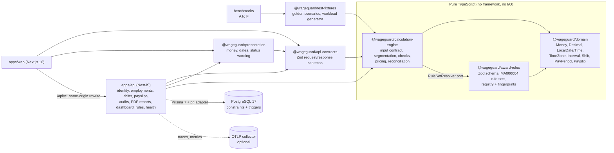

# Architecture

WageGuard is one deployable application split into modules with clear boundaries ([ADR 0001](adr/0001-modular-monolith-hexagonal.md)). The interesting part, the pay calculation, is plain TypeScript with no framework, database or network access. Everything else is built around it.

## Packages

Arrows point from a package to the package it depends on.

The engine doesn't import the rules directly. It asks for them through a small interface, `RuleSetResolver`. Today that's answered by the rule registry bundled with the code, and a database-backed store could replace it without changing the engine.

`@wageguard/presentation` holds everything a person reads: money formatting, dates shown exactly as entered, status labels and the wording of the headline amounts. The web app and the PDF report both use it, so the two can't drift apart. Telemetry is optional ([observability](observability.md)).

## How a pay period is calculated

`calculatePayPeriod(rawInput, { rules, calculatedAt })` in `packages/calculation-engine/src/calculate.ts` works in eight steps:

1. **Validate the input.** First the shape, then the meaning: real dates, a real time zone, times that exist on the day daylight saving changes, breaks inside their shifts, no overlapping shifts, no duplicate IDs, and nothing outside the pay period. Every problem is reported at once, not just the first.
2. **Find the rule set** in force for the award and pay period. A new rate applies from the first full pay period after it takes effect.
3. **Check the scope:** the award, classification, employment type and time zone, what the person has told us about their situation, their age on each day for junior rates, and part-time guaranteed hours.
4. **Split each shift** into segments. Paid time (the shift minus unpaid meal breaks) is cut at midnight and at every point where a different rate starts. Each segment gets a rule. Time outside the span of ordinary hours is overtime, and time on a public holiday gets the public holiday rule.
5. **Apply the limits.** Hours beyond the daily, guaranteed or weekly limits become overtime (last hours first), short shifts are topped up to the minimum engagement, and work before a short break between days gets the break rate. Rule sets without those rules, such as r1, flag the same situations for review instead ([ADR 0008](adr/0008-review-required-over-partial-guesses.md), [ADR 0016](adr/0016-rule-set-revisions.md)).
6. **Price the shifts** that have no blocking issue, rounding rates and lines as the rule set specifies ([ADR 0004](adr/0004-decimal-money-and-rounding.md)).
7. **Combine** the priced time into one pay line per rule for the whole period, then add allowances and leave.
8. **Decide the overall status.** The result records the rule-set version and fingerprint, the source, a hash of the input, the engine version, the rounding policy and the time of calculation. It also carries the assumptions made, every issue with its award clause and a suggested next step, and a trace of the eight steps.

`reconcile(result, payslip)` then compares the calculated minimum with the payslip. The outcome is one of: matches, possible underpayment, possible overpayment, needs review, not supported, or missing information. Each finding points back to the parts of the calculation that support it.

## Properties worth keeping

- **Same input, same answer.** The engine never reads the clock and has no randomness. Input is sorted into a canonical order before anything else happens, and a property test shuffles the input and checks the output doesn't change.
- **Every number explained.** Each segment names its rule, percentage, award clauses and any rules it overrode. Each issue names its clauses and what to do next.
- **Reproducible later.** Results carry the rule-set fingerprint and the input hash, and published rule sets can't be edited ([ADR 0003](adr/0003-versioned-immutable-rule-sets.md)).
- **Exact money.** Amounts are decimal throughout, with rounding at defined stages. Lint rules stop floating-point arithmetic creeping in ([ADR 0004](adr/0004-decimal-money-and-rounding.md)).
- **No guessing.** Hours the engine can't fully price are left out and flagged, never estimated ([ADR 0008](adr/0008-review-required-over-partial-guesses.md)).

## The API

`apps/api` is split into NestJS modules:

- identity: accounts, sessions, account deletion and the event log;
- employments;
- shifts, including CSV import;
- payslips;
- audits: calculation, reconciliation, stored snapshots, and JSON and PDF reports;
- the dashboard;
- rules, health checks and the OpenAPI document.

Each audit read loads only the columns its response needs ([ADR 0015](adr/0015-query-shape-indexes-and-fail-fast.md)). Award rules still come from the bundled registry, and a database-backed rule store hasn't been built. See also the [API](api.md) and [data model](data-model.md) docs.
