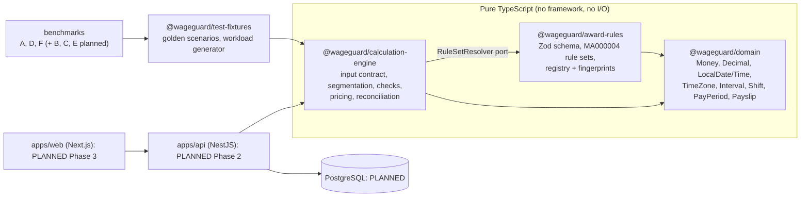

# Architecture

WageGuard is a modular monolith with hexagonal boundaries ([ADR 0001](adr/0001-modular-monolith-hexagonal.md)). This page describes what exists today and what is planned, and labels each.

## Package map

Arrows point from a dependent package to its dependency. The engine depends on the `RuleSetResolver` port. `AwardRuleRegistry` implements it today, and a persistence-backed resolver can replace it without changing the engine.

## Calculation pipeline

`calculatePayPeriod(rawInput, { rules, calculatedAt })` in `packages/calculation-engine/src/calculate.ts`:

1. **Validate.** Zod checks the structure, then the domain objects validate semantics: dates, IANA zone, DST gaps and repeats, breaks inside shifts, overlapping shifts, duplicate ids, and shifts or holidays outside the period. All problems are reported together.
2. **Resolve the rule set** by award code and pay period start, using first-full-pay-period semantics.
3. **Check scope.** Award, classification, employment type, time zone, the user's declarations (coverage, enterprise agreement, age, shiftworker) and part-time guaranteed hours.
4. **Segment** each shift's paid time (shift minus unpaid meal breaks) at local midnights and rule-window boundaries into non-overlapping segments, each classified as a rule, `OUTSIDE_SPAN` or `PUBLIC_HOLIDAY`, with precedence recorded.
5. **Entitlement checks** for situations that may change pay but are not calculated (ADR 0008).
6. **Price** shifts with no blocking issue. Rates and line amounts are rounded per the rule set's policy (ADR 0004).
7. **Aggregate** one pay line per rule for the period.
8. **Determine status** and return metadata: rule-set version and fingerprint, source, input hash, engine version, rounding policy and timestamp. The result also carries assumptions, issues with clause references and next steps, and an 8-step trace.

`reconcile(result, payslip)` compares the calculation with a payslip and produces audit findings (`MATCHED`, `POTENTIAL_UNDERPAYMENT`, `POTENTIAL_OVERPAYMENT`, `REVIEW_REQUIRED`, `UNSUPPORTED_SCENARIO`, `INCOMPLETE_DATA`). Each finding carries evidence pointers into the result.

## Design properties

| Property               | How it is achieved                                                                                                                                                           |
| ---------------------- | ---------------------------------------------------------------------------------------------------------------------------------------------------------------------------- |
| Deterministic          | No clock or randomness in the engine. Input is canonicalised (sorted) before hashing and processing. A property test runs shuffled input twice and expects identical output. |
| Explainable            | Every segment names its rule, percentage, clauses and any overridden rules. Every issue names its clauses and a next step.                                                   |
| Reproducible           | Results carry the rule-set fingerprint and input hash. Published rule sets are immutable (ADR 0003).                                                                         |
| Exact money            | `Money` and `Decimal` only, with explicit rounding stages (ADR 0004) and lint bans on float helpers.                                                                         |
| Safe under uncertainty | Unsupported or uncertain minutes are never priced (ADR 0008).                                                                                                                |

## Planned modules (not yet implemented)

Identity and authentication, employment profiles, shift and break management, award rule management, payroll calculation, payslip management, audit and reconciliation, evidence and reporting, observability, and benchmarking. These will live in `apps/api` as NestJS modules, each with application services and ports and Prisma adapters. See the [implementation checklist](implementation-checklist.md).
