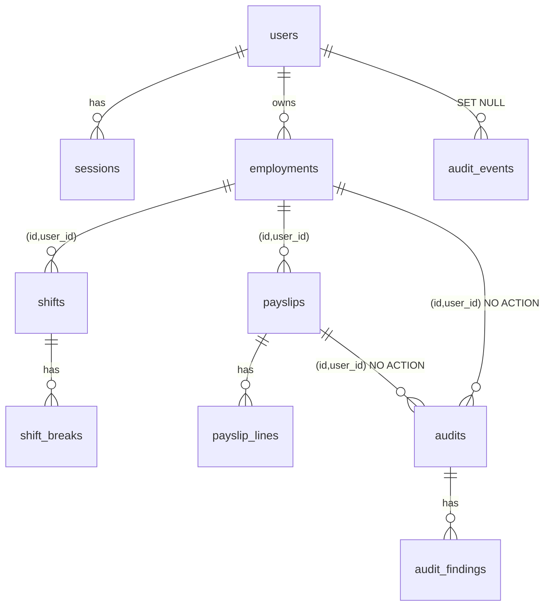

# Data model

## Domain types

These live in `packages/domain` and know nothing about the database.

| Type                                      | What it represents                                                                                     | Rules it enforces                                                                                                 |
| ----------------------------------------- | ------------------------------------------------------------------------------------------------------ | ----------------------------------------------------------------------------------------------------------------- |
| `Money`                                   | Australian dollars to the cent                                                                         | Built only from strings, rounded only on request (`fromDecimal`), never `-0`                                      |
| `Decimal`                                 | Exact decimal arithmetic (its own `decimal.js` instance, 50 significant digits)                        | Every rounding names its mode                                                                                     |
| `LocalDate`, `LocalTime`, `LocalDateTime` | Dates and times as written on a timesheet, with no time zone                                           | Minute precision and strict formats                                                                               |
| `Instant`                                 | A moment in UTC, as epoch milliseconds                                                                 | Safe integers only                                                                                                |
| `TimeZone`                                | An IANA zone such as `Australia/Sydney`                                                                | Rejects abbreviations and fixed offsets. Missing and repeated times around daylight saving are handled explicitly |
| `Interval`                                | A span from a start up to, but not including, an end                                                   | Never empty                                                                                                       |
| `EmploymentTerms`                         | Award, classification, contract type, time zone, the person's declarations, part-time guaranteed hours | Guaranteed minutes only for part-time, between 0 and 1,440 a day                                                  |
| `ShiftRecord`, `ResolvedShift`            | A shift as written, and the same shift placed in UTC                                                   | At most 24 hours. Breaks sit inside the shift and don't overlap                                                   |
| `PayPeriod`                               | A run of whole dates, inclusive                                                                        | 1 to 31 days                                                                                                      |
| `Payslip`, `PayslipLine`                  | What the person was actually paid                                                                      | Lines add up to the gross, nothing is negative, at most 100 lines                                                 |

The calculation's output types are in `packages/calculation-engine/src/result.ts` and `reconcile.ts`.

## Database

The schema is `apps/api/prisma/schema.prisma`. A few constraints Prisma can't express are written by hand at the end of the first migration (`apps/api/prisma/migrations/*_init/migration.sql`). Primary keys are UUIDv7, which sort by creation time and keep indexes tidy. Timestamps are `timestamptz(3)` in UTC. Money is `numeric(14,2)`.

Child rows point at their parent with a composite key that includes `user_id`. That way the database itself refuses a shift, payslip or audit that belongs to a different user from its employment. Triggers stop the owner of a row from ever changing.

**`users`** have a unique, lower-cased `email`.

**`sessions`** store only a SHA-256 hash of each token (unique), with indexes on `user_id` and `expires_at`.

**`employments`** have a unique `(id, user_id)` pair for the composite keys above, and an index on `(user_id, created_at)`.

**`shifts`** keep the times exactly as entered, the local `start_date` that decides which pay period they belong to, and the resolved UTC `start_at` and `end_at`. A `version` column supports safe concurrent edits. An exclusion constraint stops two shifts for the same job from overlapping, and a CHECK makes sure each one ends after it starts. They're indexed on `(employment_id, start_date)` and `(user_id, start_at)`.

**`shift_breaks`** are unique per `(shift_id, position)`.

**`payslips`** check that the period is in order and the gross isn't negative. They're indexed on `(employment_id, period_start)`, and on `(user_id, created_at DESC, id)` for the payslip history page.

**`payslip_lines`** are unique per `(payslip_id, position)`, with non-negative amounts.

**`audits`** are unique per `(user_id, idempotency_key)`, which is what makes retries safe. Each one stores a snapshot of everything used: the input, the payslip, the result, the reconciliation, the rule-set fingerprint, the input hash and the engine version. A trigger blocks UPDATE and DELETE. They're indexed on `(user_id, created_at DESC, id)` for history, and on `(user_id, finding_status, created_at DESC, shift_count, difference)`. That second index serves both the filtered history and the dashboard's totals, which can be read from it without touching the table ([ADR 0015](adr/0015-query-shape-indexes-and-fail-fast.md)).

**`audit_findings`** are unique per `(audit_id, position)` and protected by the same trigger.

**`audit_events`** is a security log with no personal details, indexed on `(user_id, occurred_at)`.

The reasoning behind these rules is in [ADR 0010](adr/0010-audits-idempotency-and-immutability.md) and [ADR 0011](adr/0011-contract-first-api-and-database-integrity.md). The indexes were checked with `EXPLAIN ANALYZE` at up to 50,000 audits in Benchmark C ([performance](performance.md)).
