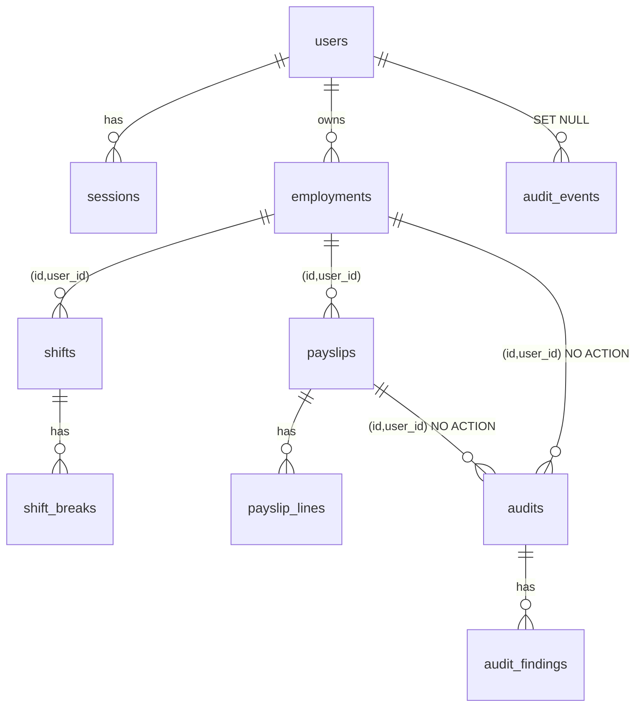

# Data model

## Domain model (implemented, `packages/domain`)

| Type                                      | Purpose                                                                       | Key invariants                                                             |
| ----------------------------------------- | ----------------------------------------------------------------------------- | -------------------------------------------------------------------------- |
| `Money`                                   | AUD at cent precision                                                         | String construction only; explicit rounding via `fromDecimal`; no `-0`     |
| `Decimal`                                 | Isolated `decimal.js` clone, 50 significant digits                            | Rounding modes named explicitly                                            |
| `LocalDate`, `LocalTime`, `LocalDateTime` | Wall-clock values with no zone                                                | Minute precision; strict formats                                           |
| `Instant`                                 | UTC epoch milliseconds                                                        | Safe integers                                                              |
| `TimeZone`                                | IANA zone                                                                     | Rejects abbreviations and fixed offsets; DST gaps and repeats are explicit |
| `Interval`                                | `[start, end)`                                                                | Non-empty; half-open                                                       |
| `EmploymentTerms`                         | Award, classification, type, zone, declarations, part-time guaranteed minutes | Guaranteed minutes only for part-time employment, 0 to 1,440               |
| `ShiftRecord`, `ResolvedShift`            | Timesheet shift and its UTC placement                                         | At most 24 h; breaks inside the shift and not overlapping                  |
| `PayPeriod`                               | Inclusive local dates                                                         | 1 to 31 days                                                               |
| `Payslip`, `PayslipLine`                  | Reported pay                                                                  | Lines sum to gross; non-negative; at most 100 lines                        |

Calculation and reconciliation output types are in `packages/calculation-engine/src/result.ts` and `reconcile.ts`.

## Persistence model (implemented)

The schema is `apps/api/prisma/schema.prisma`, plus the hand-written constraints at the end of `apps/api/prisma/migrations/*_init/migration.sql`. Primary keys are UUIDv7, which are time-ordered and index-friendly. Timestamps are `timestamptz(3)` in UTC. Money is `numeric(14,2)`.

| Table            | Key constraints and indexes                                                                                                                                                                                                                                                                                                                                                       |
| ---------------- | --------------------------------------------------------------------------------------------------------------------------------------------------------------------------------------------------------------------------------------------------------------------------------------------------------------------------------------------------------------------------------- |
| `users`          | Unique `email` (lower-cased)                                                                                                                                                                                                                                                                                                                                                      |
| `sessions`       | Unique `token_hash` (SHA-256 of the token); indexes on `user_id` and `expires_at`                                                                                                                                                                                                                                                                                                 |
| `employments`    | Unique `(id, user_id)` for composite FKs; index `(user_id, created_at)`; ownership-immutable trigger                                                                                                                                                                                                                                                                              |
| `shifts`         | FK `(employment_id, user_id)`; local wall-clock strings, plus `start_date` (pay-period attribution) and resolved `start_at`/`end_at`; `version` for optimistic concurrency; **exclusion constraint: no overlapping `[start_at, end_at)` per employment**; CHECK `end_at > start_at`; indexes `(employment_id, start_date)` and `(user_id, start_at)`; ownership-immutable trigger |
| `shift_breaks`   | Unique `(shift_id, position)`                                                                                                                                                                                                                                                                                                                                                     |
| `payslips`       | FK `(employment_id, user_id)`; CHECKs on period order and non-negative gross; ownership-immutable trigger                                                                                                                                                                                                                                                                         |
| `payslip_lines`  | Unique `(payslip_id, position)`; CHECK non-negative amount                                                                                                                                                                                                                                                                                                                        |
| `audits`         | **Unique `(user_id, idempotency_key)`**; immutable snapshot columns (input, payslip, result, reconciliation, rule-set fingerprint, input hash, engine version); indexes `(user_id, created_at desc, id)` and `(user_id, finding_status, created_at desc)`; **UPDATE and DELETE blocked by trigger**                                                                               |
| `audit_findings` | Unique `(audit_id, position)`; UPDATE and DELETE blocked by trigger                                                                                                                                                                                                                                                                                                               |
| `audit_events`   | Security event log with no personal data; index `(user_id, occurred_at)`                                                                                                                                                                                                                                                                                                          |

The integrity rules are explained in [ADR 0010](adr/0010-audits-idempotency-and-immutability.md) and [ADR 0011](adr/0011-contract-first-api-and-database-integrity.md). Index choices will be re-evaluated with `EXPLAIN ANALYZE` in Benchmark C.
