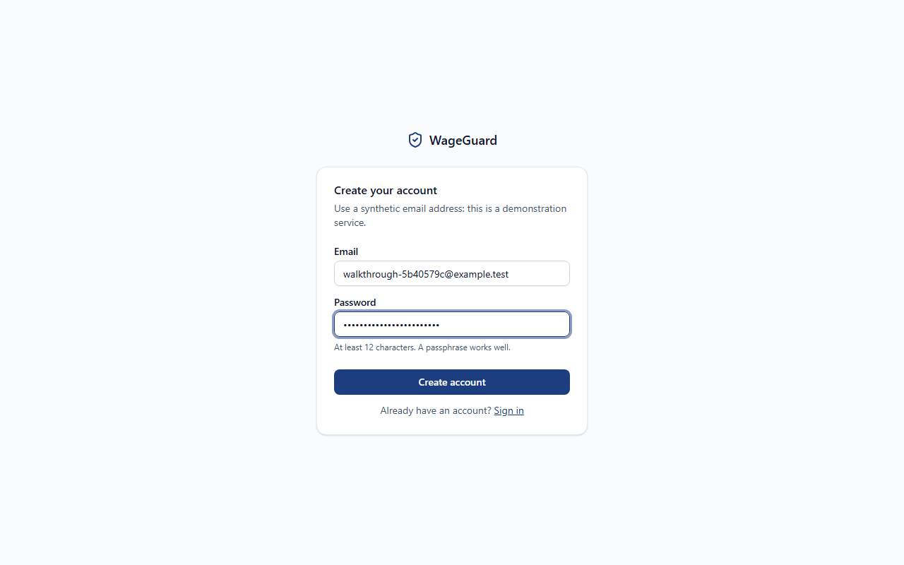
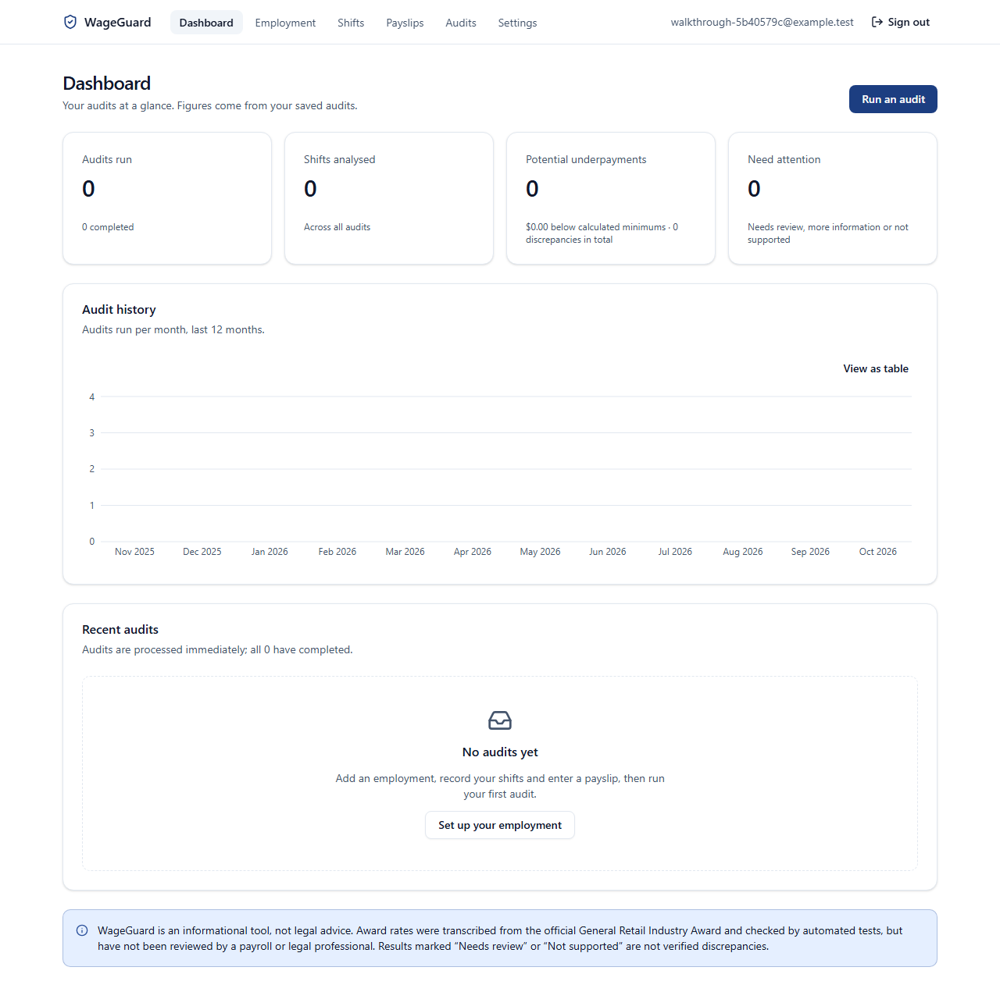
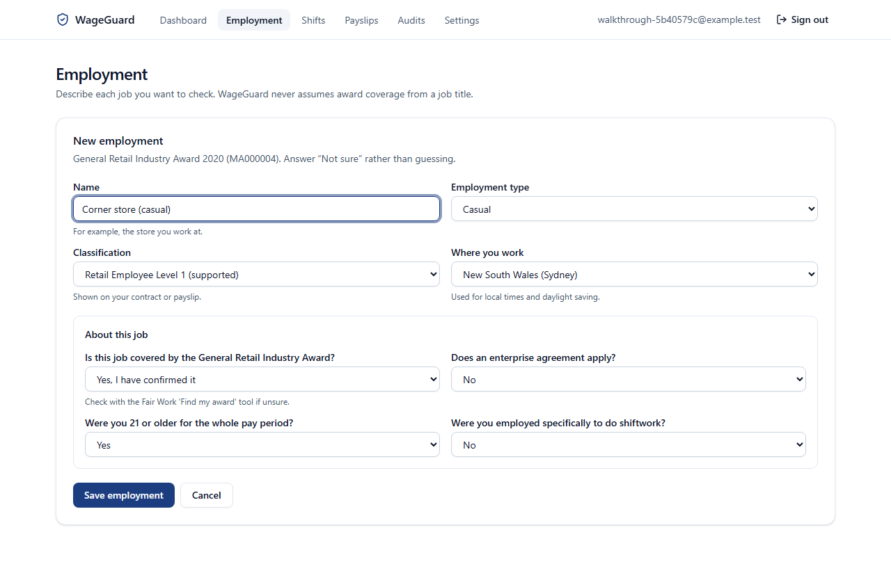
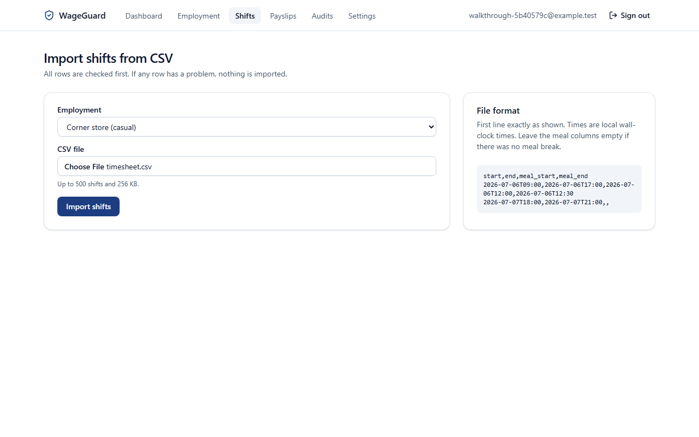
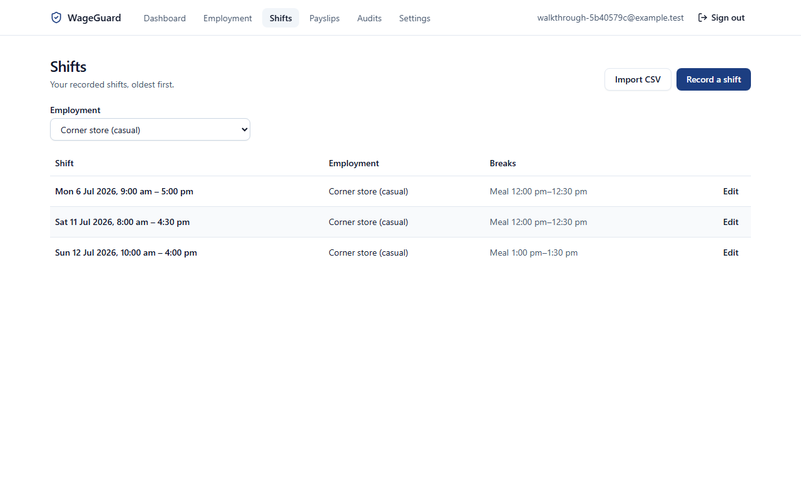
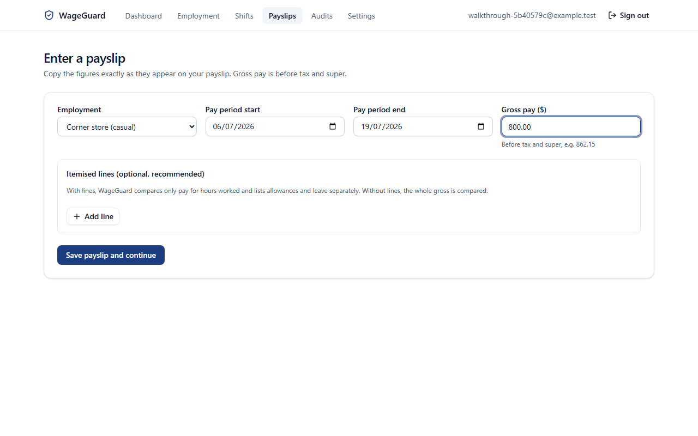
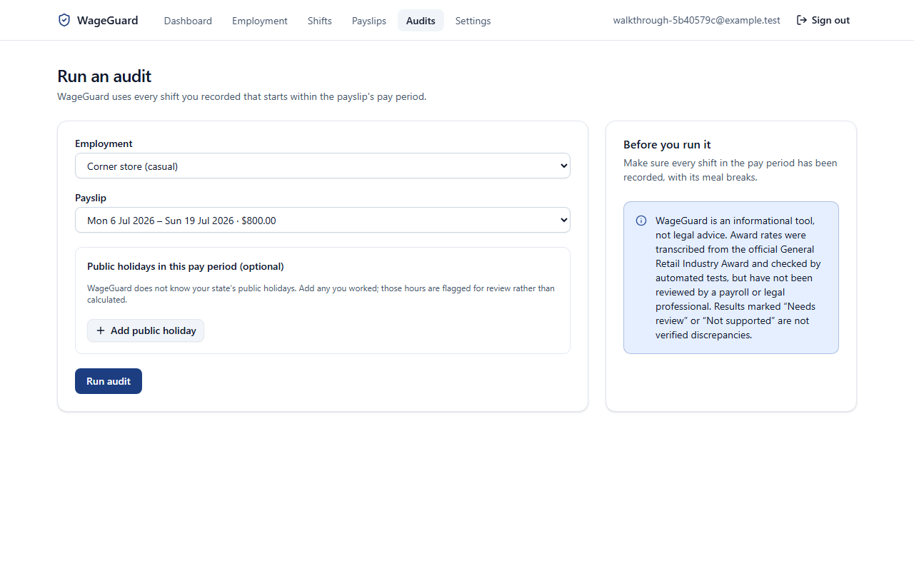
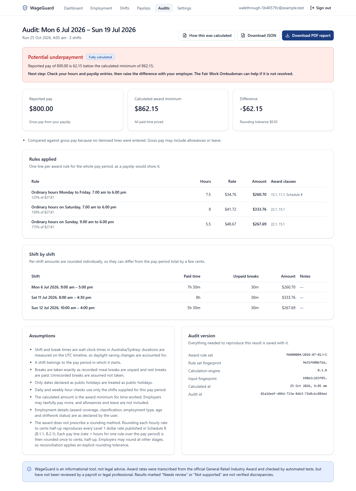
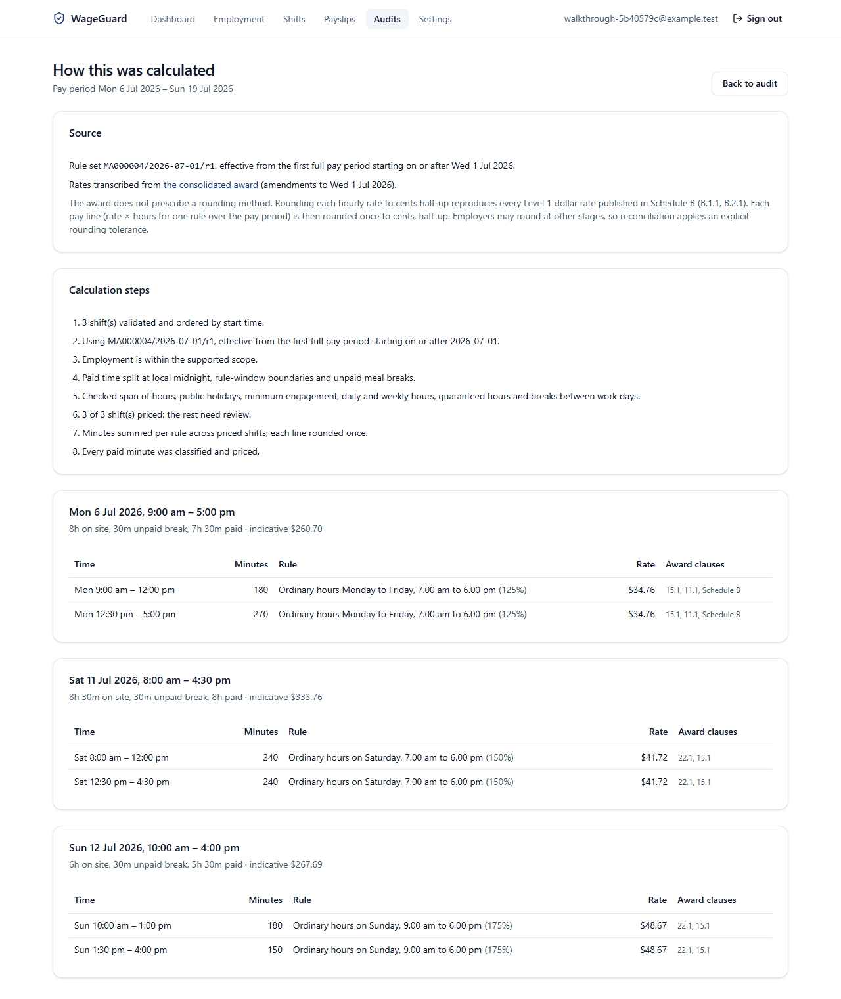

# End-to-end demonstration

This is one complete run through WageGuard. A new person signs up, describes their job, imports a fortnight of shifts, enters a payslip that's $62.15 short, and gets an audit that explains the shortfall and can be downloaded as a PDF. Everything here is synthetic.

The screenshots were taken by `pnpm --filter @wageguard/web walkthrough` against the stack started with `docker compose up --build`. The script creates its own throwaway account, so you can re-run it at any time and get the same pictures. The same journey runs as an automated test in CI on every push (`apps/web/e2e/journey.spec.ts`), so this isn't a one-off.

## 1. Sign up

An email address and a password of at least 12 characters. The page asks for a made-up email, because this is a demonstration service.

A new account starts with an empty dashboard that points to the next step.

## 2. Describe the job

WageGuard never guesses award coverage from a job title, so the person says what applies: the award, their classification, casual or part-time, their time zone, and a few yes-or-no questions about their situation. Anything outside the supported scope is refused here, before any numbers are calculated.

## 3. Import the shifts

The timesheet is a four-column CSV. Every row is checked first, and if any row has a problem, nothing is imported and the error names the line.

These three shifts are the golden scenario G009: a Monday, a Saturday and a Sunday, each with a 30-minute unpaid meal break.

## 4. Enter the payslip

The payslip says $800.00 gross for the fortnight of 6 to 19 July 2026. It can be itemised into hours, allowances and leave. Without itemised lines, the whole gross is compared.

Saving the payslip leads straight to running the audit. Public holidays can be declared here, because WageGuard doesn't know each state's holiday calendar.

## 5. The result

The award minimum for these shifts is $862.15, so the payslip is $62.15 short. That's flagged as a _potential_ underpayment, with a suggested next step. Below it are the three pay lines the award requires (weekday at 125%, Saturday at 150% and Sunday at 175% of the $27.81 base rate, casual loading included), each shift, the assumptions made, and the exact rule set and engine version used.

Hand-worked from the award's Schedule B, these are the numbers the engine reproduces:

| Shift                           | Paid time | Rate   | Amount      |
| ------------------------------- | --------- | ------ | ----------- |
| Mon 6 Jul, 9:00 am to 5:00 pm   | 7.5 h     | $34.76 | $260.70     |
| Sat 11 Jul, 8:00 am to 4:30 pm  | 8 h       | $41.72 | $333.76     |
| Sun 12 Jul, 10:00 am to 4:00 pm | 5.5 h     | $48.67 | $267.69     |
| **Total**                       |           |        | **$862.15** |

## 6. How it was calculated

Every step of the calculation is shown: which rule set was used and why, how each shift was split at the points where the rate changes, the rate for each piece, and the award clauses behind it.

## 7. The evidence report

"Download PDF report" produces a printable report built from the saved audit: the result, amounts, pay lines, payslip, shifts, assumptions and where the figures came from. The one from this run is [walkthrough/audit-report.pdf](walkthrough/audit-report.pdf). The same evidence is also available as JSON.

## What this run shows, and what it doesn't

It shows the whole supported workflow working end to end on real infrastructure: the production web and API containers and PostgreSQL. The figures match a calculation worked out by hand from the award.

It doesn't show legal accuracy. The rates were copied from the award and cross-checked automatically, but no payroll professional has reviewed them yet ([known limitations](known-limitations.md)).
