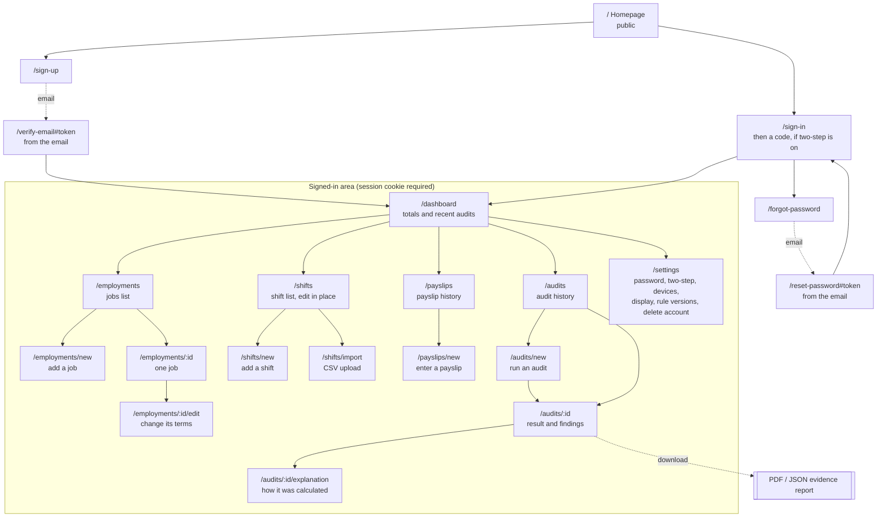
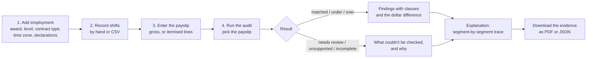

# Information architecture

This is how WageGuard's content is organised: which pages exist, how people move between them, and how each page maps onto the API and the data behind it. Every page listed here exists in `apps/web/src/app`.

## Site map

The proxy (`apps/web/src/proxy.ts`) sends anyone without a session from a signed-in page to `/sign-in?next=<page>`, and back to that page after signing in. The `next` value is checked so it can only point inside the site.

## Navigation model

There are two levels of navigation and nothing deeper.

| Level              | Where                                            | Contents                                                                                                                                                                   |
| ------------------ | ------------------------------------------------ | -------------------------------------------------------------------------------------------------------------------------------------------------------------------------- |
| Global (public)    | Homepage header                                  | In-page links (See it work, The award, Evidence, What it covers), Accessibility, Sign in, Get started                                                                      |
| Global (signed in) | Sidebar on wide screens, a menu drawer on phones | Run an audit, then Dashboard, Employment, Shifts, Payslips, Audits and Settings in labelled groups. Accessibility, and an account menu with Sign out (`POST /auth/logout`) |
| Local              | Inside a page                                    | Primary action buttons (for example "Import CSV" on Shifts) and links from a record to its detail                                                                          |

Every page starts with a "Skip to main content" link, has exactly one `h1`, and marks the current section with `aria-current="page"` in the sidebar. Pages below a list (a job, its edit form, an audit and its explanation) show breadcrumbs back to it.

## The main journey

The product has one job, auditing a pay period, and the pages are arranged around that order. A new user with nothing saved is walked through it by the dashboard's empty state.

## Page inventory

| Page                                                   | Purpose                                | Main content                                                                                               | Reads from the API                                                                     | Writes to the API                                                                           |
| ------------------------------------------------------ | -------------------------------------- | ---------------------------------------------------------------------------------------------------------- | -------------------------------------------------------------------------------------- | ------------------------------------------------------------------------------------------- |
| `/`                                                    | Explain the product and earn trust     | Hero, animated sample audit, award quotes, evidence figures, scope                                         | none (quotes come from the bundled rule set at build time)                             | none                                                                                        |
| `/sign-up`, `/sign-in`                                 | Get a session                          | Email and password, then a code if two-step sign-in is on. Sign-up ends at "check your inbox"              | none                                                                                   | `POST /auth/register`, `POST /auth/login`, `POST /auth/login/two-factor`                    |
| `/verify-email`, `/forgot-password`, `/reset-password` | Confirm an address, recover an account | The token is read from the link's fragment and removed from the address bar                                | none                                                                                   | `POST /auth/verify-email`, `POST /auth/password-reset`, `POST /auth/password-reset/confirm` |
| `/dashboard`                                           | Where things stand                     | Totals by finding status, the latest audits, next step                                                     | `GET /dashboard`                                                                       | none                                                                                        |
| `/employments`, `/employments/new`                     | The jobs being checked                 | Cards per job, and a sectioned form for a new one                                                          | `GET /employments`                                                                     | `POST /employments`                                                                         |
| `/employments/:id/edit`                                | Change a job's terms                   | The same form, filled in. Past audits keep their terms                                                     | `GET /employments/:id`                                                                 | `PATCH /employments/:id`                                                                    |
| `/employments/:id`                                     | One job's terms                        | Award, level, declarations, what's supported                                                               | `GET /employments/:id`                                                                 | none                                                                                        |
| `/shifts`                                              | Worked time                            | Filterable, paginated list, with editing in a dialog                                                       | `GET /shifts`, `GET /employments`                                                      | `PATCH /shifts/:id`                                                                         |
| `/shifts/new`                                          | Add a shift                            | Start and end, breaks, daylight-saving prompts                                                             | `GET /employments`                                                                     | `POST /shifts`                                                                              |
| `/shifts/import`                                       | Bulk entry                             | CSV example, upload, line-numbered errors                                                                  | `GET /employments`                                                                     | `POST /shifts/import`                                                                       |
| `/payslips`, `/payslips/new`                           | What was paid                          | History, and gross or itemised entry                                                                       | `GET /payslips`, `GET /employments`                                                    | `POST /payslips`                                                                            |
| `/audits`, `/audits/new`                               | Run and find audits                    | History filtered by status. The run form adds the state's holidays and pay-period extras                   | `GET /audits`, `GET /payslips`, `GET /employments`, `GET /public-holidays`             | `POST /audits` (with an idempotency key)                                                    |
| `/audits/:id`                                          | The answer                             | Headline status, difference, findings, assumptions, report downloads                                       | `GET /audits/:id`, `GET /audits/:id/lines`, and the two report routes when downloading | none                                                                                        |
| `/audits/:id/explanation`                              | How the answer was reached             | Calculation steps, pay lines, per-shift segments                                                           | `GET /audits/:id/report`                                                               | none                                                                                        |
| `/settings`                                            | Control                                | Account, password, two-step sign-in, signed-in devices, display preferences, rule versions, delete account | `GET /auth/me`, `GET /auth/sessions`, `GET /rules/versions`                            | `POST /auth/password`, `/auth/two-factor/*`, `DELETE /auth/sessions`, `DELETE /auth/me`     |

## Content hierarchy on a result page

A result page is read from the top down, and each layer answers the question the previous one raises:

1. **Status and difference.** "Potential underpayment, $62.15". This is the only thing most people need.
2. **Findings.** One card per issue, each with its explanation, the clauses, the shifts involved and a next step.
3. **Assumptions and notes.** What WageGuard took as given, such as the employee's declared age band.
4. **Explanation page.** The full trace, down to each priced segment of each shift.
5. **Evidence report.** The same content as a file that can be kept or shared.

Statuses are never shown by colour alone. Each one has a label and an icon as well, and "matched" is worded as "matches the calculated minimum" rather than a green tick, because WageGuard can't certify that a payslip is correct.

## Naming

Labels follow the words people use on payslips and timesheets, not internal names. For example, "Employment" rather than "engagement", "Needs review" rather than `REVIEW_REQUIRED`, and "How this was calculated" rather than "trace". The status wording lives in one place (`apps/web/src/lib/status.ts`) and is shared with the PDF through `packages/presentation`, so the screen and the report always agree.
