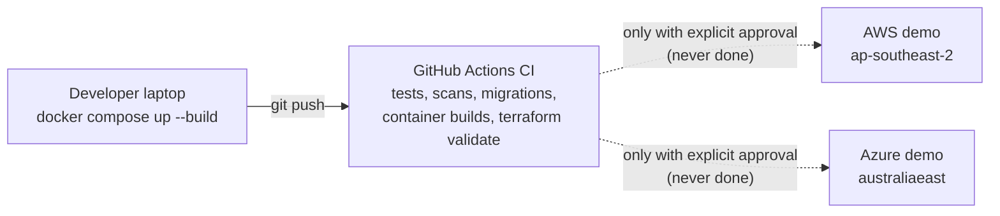
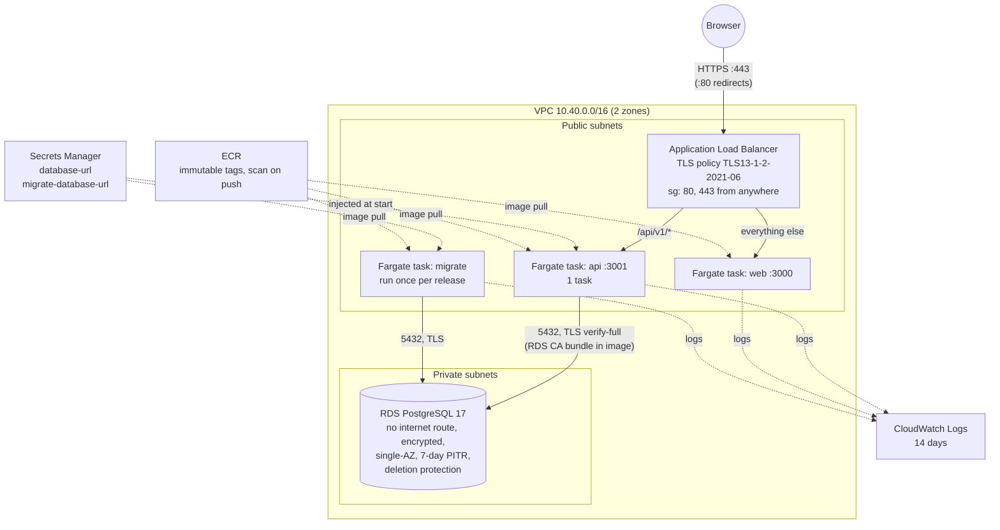
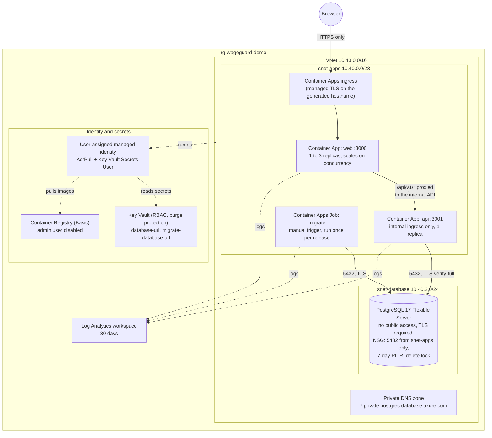
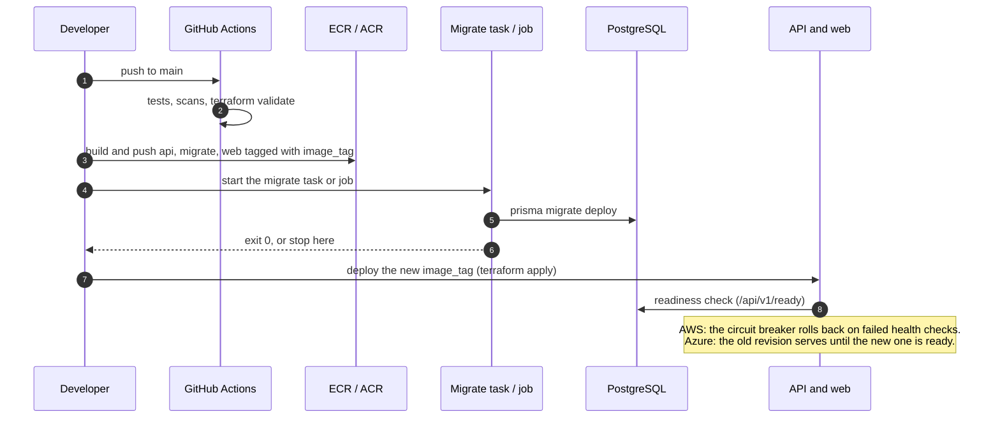
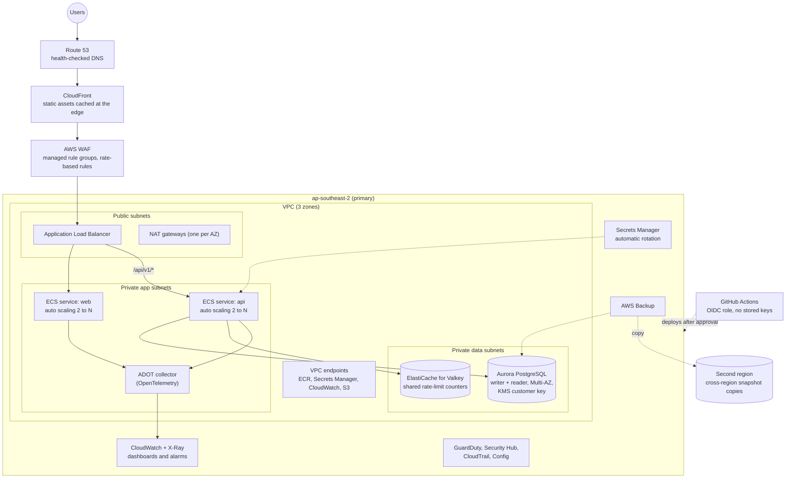
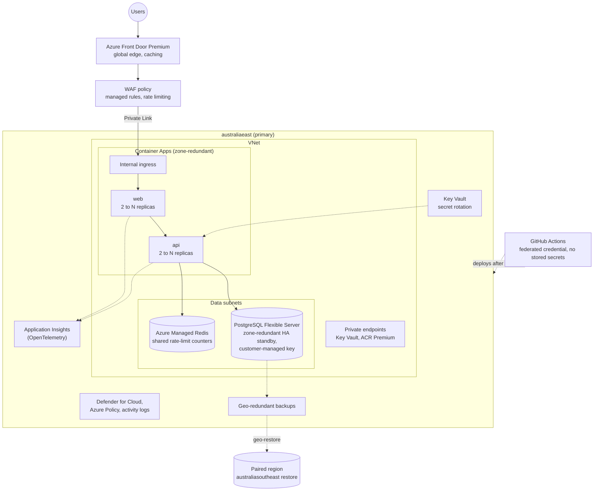

# Infrastructure and cloud design

WageGuard runs locally with Docker Compose, and has Terraform for two optional cloud deployments: AWS (`infra/aws`) and Azure (`infra/azure`). Both are written, formatted and validated on every push. **Neither has ever been applied**, because applying creates billable resources. Everything below that describes cloud behaviour is a design, not an observation.

|             | Local (Docker Compose)    | AWS                                  | Azure                                |
| ----------- | ------------------------- | ------------------------------------ | ------------------------------------ |
| Status      | Runs, tested daily        | Written and validated, never applied | Written and validated, never applied |
| Compute     | Containers on one machine | ECS Fargate                          | Container Apps (Consumption)         |
| Database    | `postgres:17.6-alpine`    | RDS for PostgreSQL 17                | PostgreSQL 17 Flexible Server        |
| Secrets     | `.env` file, git-ignored  | Secrets Manager                      | Key Vault (RBAC)                     |
| Entry point | `localhost:3000`          | Application Load Balancer            | Container Apps ingress               |
| Logs        | `docker compose logs`     | CloudWatch Logs                      | Log Analytics                        |
| Terraform   | n/a                       | 1.16.5, aws 6.68.0, random 3.7.2     | 1.16.5, azurerm 5.9.0, random 3.7.2  |

## Design principles

Both clouds follow the same rules, so either could be chosen without changing the application.

- **The database is never public.** It sits in a private subnet with no internet route and accepts connections only from the application.
- **No secret appears in code, images or task definitions.** Connection strings are generated by Terraform, stored in the cloud's secret store, and injected when a container starts.
- **TLS everywhere, verified.** HTTPS at the edge, and the API verifies the database's certificate.
- **Migrations are a separate, one-off job.** They run before a release and are never part of a running service, so a failed migration can't take the site down with it.
- **One API instance, by choice.** Rate-limit counters are shared through PostgreSQL, so more API instances would keep the same limits; one keeps the demonstration cheap. The web app holds no state and could scale out too.
- **Cheap by default.** Smallest sensible sizes and single-zone databases, because this is a demonstration. The [post-finish designs](#post-finish-prototype-designs-proposed-not-built) show what production would add.
- **Synthetic data only.** Every resource is tagged `Data = synthetic-only`.

## Environments



Today there is one environment per cloud, named by the `environment` variable (`demo` by default). A real product would keep development, staging and production apart: each in its own AWS account or Azure subscription, each with its own state file and `.tfvars`, and promotion by deploying the same image tag to each in turn. See [the proposed repository layout](#infrastructure-repository-structure).

## AWS environment architecture



The VPC has two public subnets (10.40.0.0/24 and 10.40.1.0/24) and two private ones (10.40.10.0/24 and 10.40.11.0/24), one of each per availability zone. The tasks sit in the public subnets with public IPs so they can pull images without a NAT gateway, which would be the largest fixed cost of a small demo. Their security group only accepts traffic from the load balancer on ports 3000 and 3001, and they can only send HTTPS and PostgreSQL traffic. The load balancer's path rule sends `/api/v1/*` straight to the API, so the browser sees one site and cookies work exactly as they do locally. The API trusts one proxy hop (`TRUST_PROXY=1`), so rate limits apply per visitor.

Deploying is described step by step in [deployment](deployment.md#aws-designed-validated-never-deployed).

## Azure environment architecture



Both subnets are delegated: the app subnet to Container Apps and the database subnet to PostgreSQL. Azure has no load balancer that splits paths in this design. The web app is the only public endpoint, and it already proxies `/api/v1/*` to whatever `API_ORIGIN` it was built with, which is how Docker Compose works too. So the API gets internal-only ingress, and the web image is built with `--build-arg API_ORIGIN=http://ca-wageguard-demo-api` (the `api_origin` output). The database certificate chains to a public root CA that is already trusted by the images, so the API verifies it without a bundle.

The containers never see a password or key. They run as a user-assigned managed identity that can pull images and read the two secrets, and nothing else. The person running Terraform gets "Key Vault Secrets Officer" on the vault so Terraform can write the secrets.

What hasn't been tested on Azure, beyond everything in the AWS list:

- **Rate limits behind the proxy.** API traffic reaches the API through the platform ingress and the web app, so without the right `TRUST_PROXY` hop count every visitor would share one rate-limit budget. It's deliberately left unset until the real number of hops can be measured on a deployment, because guessing too high lets a client choose their own address.
- **Custom domain.** The configuration uses the generated `*.azurecontainerapps.io` hostname. Binding a domain and certificate is a manual step, and `ALLOWED_ORIGINS` would need to follow.

### AWS and Azure side by side

| Concern                    | AWS                                         | Azure                                                     |
| -------------------------- | ------------------------------------------- | --------------------------------------------------------- |
| Network                    | VPC, 2 public + 2 private subnets           | VNet, 2 delegated subnets                                 |
| Who can reach the database | Security group: tasks only                  | NSG: app subnet only, plus VNet injection                 |
| Public entry               | ALB with path routing                       | Container Apps external ingress on the web app            |
| API exposure               | Behind the ALB                              | Internal ingress, reached through the web app             |
| Images                     | ECR, immutable tags, scan on push           | ACR Basic, pulled by managed identity                     |
| Secret delivery            | Execution role reads Secrets Manager        | Managed identity reads Key Vault                          |
| Database TLS trust         | RDS CA bundle baked into the API image      | Public root already in the image trust store              |
| Migrations                 | One-off ECS task (`migrate_command` output) | Manual Container Apps Job (`migrate_job` output)          |
| Accidental deletion        | RDS deletion protection + final snapshot    | Management lock on the server, Key Vault purge protection |
| Rollback                   | ECS deployment circuit breaker              | Single-revision mode; redeploy the previous tag           |

## Infrastructure repository structure

What's in the repository now:

```text
infra/
├── aws/
│   ├── versions.tf               Terraform and provider pins, provider tags, backend placeholder
│   ├── variables.tf              region, environment, domain, certificate, image tag, sizes
│   ├── network.tf                VPC, subnets, routes, security groups
│   ├── load-balancer.tf          ALB, target groups, HTTPS listener, /api/v1/* rule, HTTP redirect
│   ├── database.tf               RDS, generated password, both database URLs in Secrets Manager
│   ├── containers.tf             ECR, CloudWatch, IAM, task definitions, ECS services
│   ├── outputs.tf                load balancer DNS name, ECR URLs, migrate command
│   ├── terraform.tfvars.example  copy to terraform.tfvars (git-ignored)
│   └── .terraform.lock.hcl       provider checksums, committed
└── azure/
    ├── versions.tf               pins, provider features, locals, resource group
    ├── variables.tf              subscription, location, environment, image tag, sizes
    ├── network.tf                VNet, delegated subnets, NSG, private DNS zone
    ├── database.tf               Flexible Server, database, TLS setting, delete lock
    ├── secrets.tf                managed identity, Key Vault, role assignments, secrets
    ├── containers.tf             Log Analytics, ACR, environment, api, web, migrate job
    ├── outputs.tf                URL, registry, API origin for the web build, job name
    ├── terraform.tfvars.example
    └── .terraform.lock.hcl
```

Each cloud is a single root module with files split by concern, which is easy to read at this size. If WageGuard grew to several environments, the layout would change to shared modules plus one small root per environment, so that staging and production differ only in their variables:

```text
infra/                            (proposed, not built)
├── modules/
│   ├── aws-network/  aws-database/  aws-service/
│   └── azure-network/  azure-database/  azure-container-app/
└── live/
    ├── aws/
    │   ├── staging/      main.tf, backend.tf, staging.tfvars
    │   └── production/   main.tf, backend.tf, production.tfvars
    └── azure/
        ├── staging/
        └── production/
```

## Terraform command line cases

Terraform runs from Docker here, so no local install is needed. All commands are run from inside `infra/aws` or `infra/azure`. With a local install, drop the `docker run ...` prefix.

```bash
# Run Terraform 1.16.5 against the current folder (PowerShell: use ${PWD} instead of $(pwd))
alias tf='docker run --rm -it -v "$(pwd)":/work -w /work hashicorp/terraform:1.16.5'
```

The last column says whether that command has actually been run for this project. Anything that needs cloud credentials hasn't, because nothing has been deployed.

| Case                       | Command                                                                                                        | What it's for                                                                                   | Run here?           |
| -------------------------- | -------------------------------------------------------------------------------------------------------------- | ----------------------------------------------------------------------------------------------- | ------------------- |
| Check formatting           | `tf fmt -check -recursive`                                                                                     | Fails if any file isn't in canonical format. CI runs it                                         | Yes, every push     |
| Fix formatting             | `tf fmt -recursive`                                                                                            | Rewrites files into canonical format                                                            | Yes                 |
| Initialise for checks only | `tf init -backend=false -input=false -lockfile=readonly`                                                       | Downloads the pinned providers and refuses to change the lock file. CI runs it                  | Yes, every push     |
| Validate                   | `tf validate`                                                                                                  | Type-checks the configuration against the provider schemas                                      | Yes, every push     |
| Lock for several platforms | `tf providers lock -platform=linux_amd64 -platform=linux_arm64 -platform=darwin_arm64 -platform=windows_amd64` | Records checksums so every machine downloads identical providers                                | Yes, when pinning   |
| Upgrade a provider         | Edit the version in `versions.tf`, then `tf init -upgrade`                                                     | Moves to a new release (at least two weeks old, per [ADR 0006](adr/0006-toolchain-versions.md)) | Yes, when pinning   |
| Initialise for real        | `tf init` with a `backend` block configured                                                                    | Connects to remote, encrypted, locked state                                                     | No                  |
| Plan to a file             | `tf plan -out=release.tfplan`                                                                                  | Shows every change and saves exactly that plan                                                  | No                  |
| Apply a reviewed plan      | `tf apply release.tfplan`                                                                                      | Applies only what was reviewed, nothing that changed since                                      | No (needs approval) |
| Detect drift               | `tf plan -detailed-exitcode`                                                                                   | Exit code 2 means the real resources differ from the code                                       | No                  |
| Accept out-of-band changes | `tf apply -refresh-only`                                                                                       | Updates state to match reality without changing resources                                       | No                  |
| Read outputs               | `tf output` or `tf output -raw api_origin`                                                                     | URLs, registry names, the migrate command                                                       | No                  |
| Inspect state              | `tf state list`, `tf state show azurerm_postgresql_flexible_server.main`                                       | See what Terraform is tracking                                                                  | No                  |
| Adopt an existing resource | `import { to = ..., id = "..." }` block, then plan                                                             | Bring something made by hand under management                                                   | No                  |
| Rebuild one resource       | `tf apply -replace=azurerm_container_app.web`                                                                  | Force a fresh replacement                                                                       | No                  |
| Rename without destroying  | `moved { from = ..., to = ... }` block                                                                         | Refactor addresses safely                                                                       | No                  |
| Clear a stuck lock         | `tf force-unlock <lock id>`                                                                                    | Only after confirming no other run is active                                                    | No                  |
| Tear down                  | Remove deletion protection or the lock, then `tf destroy`                                                      | End the demo and stop the billing                                                               | No (needs approval) |

Two things are deliberately avoided. `-target` applies part of a configuration and leaves the rest out of step, so it's kept for emergencies and one bootstrap step: the first Azure deployment creates the registry on its own so the images can be pushed before the apps that pull them ([deployment](deployment.md#azure-designed-validated-never-deployed)). `-auto-approve` is never used outside a pipeline with its own approval gate.

## Release flow

Both clouds release the same way, and the order matters: the database is migrated before new code that depends on it starts.



Because the migration runs while the previous release is still serving, each migration has to keep working with the old code: add a column or table in one release, and remove the old one in a later release. The two migrations so far add tables and indexes (one index was swapped for a wider one), so removing a column this way hasn't been tried yet.

## Cost

No cost estimate is given here, because none has been measured and prices vary by region and change over time. The fixed costs come from the parts that run around the clock: on AWS the load balancer, the RDS instance and the two Fargate tasks; on Azure the Flexible Server, the always-on API replica and the minimum web replica. Use the AWS Pricing Calculator or the Azure Pricing Calculator for the target region before applying, and destroy the demo when it's finished.

## Post-finish prototype designs (proposed, not built)

These diagrams are what a production deployment would look like once the known limitations are fixed. **None of it is written as Terraform, validated or costed.** They're here to show where the current design would go next and why.

The application changes that unlock them are small and already understood: move the rate-limit counters from PostgreSQL into Redis or Valkey (they're already shared across instances, but each request costs a database write), turn on the existing OpenTelemetry support ([ADR 0013](adr/0013-opt-in-opentelemetry.md)), and add a managed WAF in front.

### AWS, production shape



### Azure, production shape



### What each addition is for

| Addition                                  | Problem it solves                                                   | Both clouds?                           |
| ----------------------------------------- | ------------------------------------------------------------------- | -------------------------------------- |
| Shared Redis/Valkey for rate limits       | The API can't run more than one instance today                      | Yes                                    |
| Multi-zone database with a standby        | A single-zone database is a single point of failure                 | Yes                                    |
| WAF at the edge                           | Abusive traffic is only rate-limited inside the app today           | Yes                                    |
| Private app subnets with NAT or endpoints | Tasks currently use public IPs to reach the registry                | AWS (Azure apps are already VNet-only) |
| OIDC or federated credentials for CI      | Deployments without long-lived cloud keys                           | Yes                                    |
| Cross-region backup copies                | Recovery if a whole region is lost                                  | Yes                                    |
| OpenTelemetry collector                   | Traces and metrics already exist in the code but are off by default | Yes                                    |

The full list of known gaps is in [known limitations](known-limitations.md).
