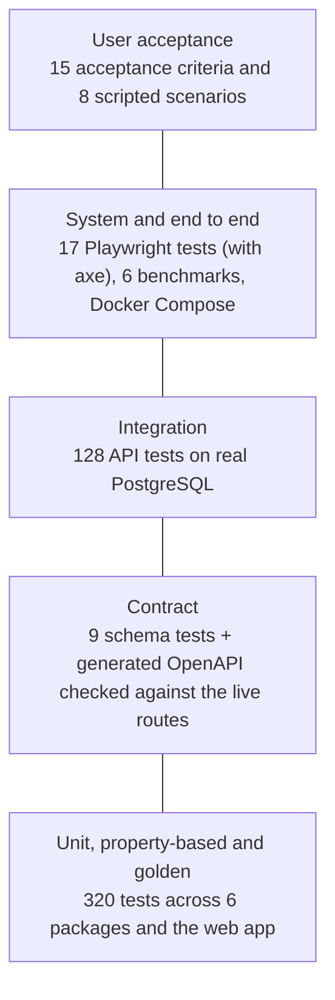

# Testing

WageGuard is tested at five levels, from single functions up to a person using the product. Each level catches a different kind of mistake, and the levels below a certain point use real infrastructure rather than mocks: the API tests run against PostgreSQL with the real migrations, and the browser tests run against the production web build.



| Level                       | Count                                       | Where                                                                                                                         | What it proves                                                                |
| --------------------------- | ------------------------------------------- | ----------------------------------------------------------------------------------------------------------------------------- | ----------------------------------------------------------------------------- |
| Unit                        | 320 in total with property and golden tests | `packages/*/test`, `apps/web/src/lib/lib.test.ts`                                                                             | Each function does what it says, including edge cases                         |
| Property-based (fast-check) | included above                              | `packages/domain/test/{money,interval,canonical,offset-table}.test.ts`, `packages/calculation-engine/test/properties.test.ts` | Rules that must hold for thousands of random inputs                           |
| Golden scenarios            | included above                              | `packages/test-fixtures/test/golden.test.ts`, `pnpm benchmark:correctness`                                                    | Hand-worked award examples give the expected dollars, or are refused          |
| Contract                    | 9                                           | `packages/api-contracts/test`, plus the route check in `apps/api/test/platform.test.ts`                                       | Requests are validated by the same schemas the docs are generated from        |
| Integration                 | 128                                         | `apps/api/test/*.test.ts`                                                                                                     | The API, its guards and the database constraints work together                |
| System and end to end       | 17                                          | `apps/web/e2e/*.spec.ts`                                                                                                      | A person can complete the job in a real browser, and the pages are accessible |
| Non-functional system tests | 6 benchmarks                                | `benchmarks/`                                                                                                                 | Speed, correctness at scale, database query plans, behaviour under failure    |
| User acceptance             | 15 criteria, 8 scenarios                    | [acceptance](acceptance.md), [demo](demo.md), below                                                                           | The product meets the brief from the user's side                              |

The unit, contract and integration tests add up to 457, and all of them run with `pnpm test`. The 17 browser tests run separately.

## Unit testing

Unit tests cover the pure packages, which hold all of the pay logic: `domain` (money, time, intervals, shifts), `award-rules` (the rule-set registry), `calculation-engine`, `presentation` (wording and formatting shared by the screen and the PDF) and the web app's form and display helpers. They need no database or network, and the whole set runs in a few seconds.

The engine is tested against the award, not against itself. For example, `casual Sunday: 5.5h x $48.67 = $267.685 -> $267.69 (half-up)` checks one published rate, one rounding rule and one clause in a single assertion.

### Properties the engine must always satisfy

The property-based tests generate thousands of random inputs and check rules that should hold for every one of them:

- Paid time split into segments adds back up to the shift minus its unpaid meal breaks, with no overlaps, gaps or empty segments.
- The pay-period total equals the sum of its lines and is never negative. Each line is within half a cent of the exact product.
- A fully calculated result has priced every paid minute. Any other status names at least one reason. Hours outside the span and on public holidays are never priced.
- The same input always gives the same output, whatever order the shifts arrive in.
- Unsupported or unconfirmed employment is never priced.
- When daylight saving starts during a shift, its elapsed time is the wall-clock time minus the missing hour.

The domain types get the same treatment. Adding money is associative and commutative, subtracting undoes adding, and values survive a JSON round trip. Interval subtraction is checked minute by minute. Canonical hashing ignores key order. The cached time-zone offsets match a direct lookup at 5,000 random instants across 8 zones.

## Integration testing

The API tests in `apps/api/test` start a throwaway `postgres:17.6-alpine` container for each run, apply the real migrations, and call the API over HTTP with Supertest. Nothing is mocked between the controller and the database, so the constraints and triggers being tested are the ones production has. They cover:

- **Authentication**: hashing, session storage, cookie flags, logout revoking the session, and simultaneous sign-ups.
- **Authorisation**: every object route tried as another user (`security.test.ts`), and database-level ownership that holds even if the application is bypassed.
- **Data integrity**: the shift-overlap exclusion constraint, optimistic locking with concurrent updates, atomic CSV import, idempotent audit creation under 10 concurrent requests, and the trigger that makes audits immutable.
- **Platform**: security headers, correlation IDs, CSRF origin checks, rate limits with and without a trusted proxy, and the error body.
- **Reports**: the PDF is parsed back to text and checked for wording, amounts and page breaks.
- **Telemetry**: spans and metrics are captured in memory and checked for the absence of pay data and identities.

## System testing

System tests treat WageGuard as a whole, running the way it's deployed:

- **End to end**: Playwright drives Chromium against `next build` output, a real API and PostgreSQL. The three journey tests cover the main job, an underpayment and a rejected CSV.
- **Accessibility**: axe-core scans every page state for WCAG 2.1 A and AA problems, in the default theme and again in dark mode, high contrast and the two larger text sizes. Other tests check the skip link, the accessibility panel and the pause controls. See [ACCESSIBILITY.md](../ACCESSIBILITY.md).
- **Security in the browser**: the CSP test checks every script carries the request's nonce, the nonce changes per request, and no page reports a violation.
- **Benchmarks**: the engine at scale (A), the API under 50 concurrent clients (B), database query plans at 50,000 audits (C), coverage (D), behaviour with the API killed and the database stopped (E), and golden correctness (F). Results and conditions are in [performance](performance.md).
- **Containers**: CI builds the API and web images and scans them for fixable high and critical vulnerabilities. The images are started and used together in the Docker Compose stack, which is how the app runs locally and how the screenshots and walkthrough were captured.

## User acceptance testing

No outside users have tested WageGuard. User acceptance here means scenarios written from a user's point of view and run against the full local stack by the developer, with most of them also automated so they can't quietly regress. The fifteen project-level criteria are in [acceptance](acceptance.md). These are the user-facing scenarios:

| ID     | As a...                                     | I want to...                                           | Accepted when                                                                        | Result (2026-10-25) | Evidence                                                              |
| ------ | ------------------------------------------- | ------------------------------------------------------ | ------------------------------------------------------------------------------------ | ------------------- | --------------------------------------------------------------------- |
| UAT-01 | casual retail worker                        | check a fortnight's payslip                            | I can go from sign-up to a result in one sitting without help                        | Pass                | [demo walkthrough](demo.md), `journey.spec.ts`                        |
| UAT-02 | underpaid worker                            | see how much I'm owed and why                          | The difference is shown in dollars, with the clauses and shifts involved             | Pass                | `journey.spec.ts` (underpayment)                                      |
| UAT-03 | worker with a timesheet export              | import my shifts from a CSV                            | Valid files import in one go, and a bad line is named with nothing half-imported     | Pass                | `journey.spec.ts` (malformed CSV), `shifts.test.ts`                   |
| UAT-04 | worker with something WageGuard can't price | not be told I was paid correctly when I wasn't checked | The audit says "needs review" or "not calculated" and names what couldn't be checked | Pass                | `audits.test.ts`, [screenshot](screenshots/05-audit-needs-review.png) |
| UAT-05 | worker talking to my employer               | take the evidence with me                              | The PDF and JSON reports download and match the screen                               | Pass                | `journey.spec.ts`, `audits.test.ts` (PDF text)                        |
| UAT-06 | person with low vision                      | make the text larger and the contrast higher           | The settings apply at once, survive a reload, and the pages still pass axe           | Pass                | `access.spec.ts` (panel, three display modes)                         |
| UAT-07 | person sensitive to motion                  | stop the homepage animations                           | Every moving element has a pause control, and reduced motion stops them all          | Pass                | `access.spec.ts` (pause and reduced motion)                           |
| UAT-08 | privacy-conscious user                      | delete everything I've entered                         | One action, confirmed with my password, removes every row including audits           | Pass                | `security.test.ts`, Settings page                                     |

## Test cases

A sample of the most important cases across the levels. Every one maps to a named test that ran in the run recorded on 2026-10-25. The full list is whatever `pnpm test` and the Playwright suite report.

| ID    | Level       | Scenario                                                    | Expected result                                         | Result | Test                                                                      |
| ----- | ----------- | ----------------------------------------------------------- | ------------------------------------------------------- | ------ | ------------------------------------------------------------------------- |
| TC-01 | Unit        | Casual weekday, 7.5 hours                                   | 7.5 × $34.76 = $260.70                                  | Pass   | `calculate.test.ts`: casual weekday ordinary hours                        |
| TC-02 | Unit        | Casual Sunday, 5.5 hours                                    | $267.685 rounds half-up to $267.69                      | Pass   | `calculate.test.ts`: casual Sunday                                        |
| TC-03 | Unit        | Casual Saturday                                             | 150% casual rate, loading not added twice               | Pass   | `calculate.test.ts`: casual Saturday uses the Table 12 casual rate        |
| TC-04 | Unit        | Part-time shift crossing 6 pm                               | Split into ordinary and evening lines                   | Pass   | `calculate.test.ts`: part-time shift crossing 6 pm                        |
| TC-05 | Unit        | Casual work after 9 pm on a weekday                         | Overtime outside the span, at 175%                      | Pass   | `r2.test.ts`: prices casual work after 9 pm on a weekday as overtime      |
| TC-06 | Unit        | Labour Day in NSW                                           | 4 h × $69.53 at the casual public holiday rate          | Pass   | `r2.test.ts`: pays work on a public holiday at the public holiday rate    |
| TC-07 | Unit        | Casual week over 38 hours                                   | The last hours worked are overtime                      | Pass   | `r2.test.ts`: pays a casual's hours beyond 38 in a week as overtime       |
| TC-08 | Unit        | Less than 12 hours between work days                        | Paid at 225% for a casual until a full break            | Pass   | `r2.test.ts`: pays work before a 12-hour break at 200%                    |
| TC-09 | Unit        | Overnight shift across the daylight-saving change           | 2 hours, not 3                                          | Pass   | `calculate.test.ts`: measures an overnight shift across the DST change    |
| TC-10 | Unit        | Wall-clock time inside the DST gap                          | Rejected with a domain issue code                       | Pass   | `time.test.ts`: rejects a wall-clock time inside the gap                  |
| TC-11 | Unit        | Money built from a JavaScript number                        | Rejected at runtime                                     | Pass   | `money.test.ts`: rejects JavaScript numbers at runtime                    |
| TC-12 | Property    | Random shifts and breaks                                    | Segments add back to paid time with no gaps or overlaps | Pass   | `properties.test.ts`                                                      |
| TC-13 | Property    | Same shifts in a different order                            | Identical output and input hash                         | Pass   | `properties.test.ts`, `calculate.test.ts`                                 |
| TC-14 | Unit        | Published rule set edited after publishing                  | Registry refuses to load it                             | Pass   | `registry.test.ts`: rejects a published rule set whose content was edited |
| TC-15 | Unit        | Rate change between pay periods                             | Period uses the rule set in force when it started       | Pass   | `calculate.test.ts`: keeps the old rule set for a pay period              |
| TC-16 | Unit        | Payslip within rounding tolerance                           | Matched, and just beyond it is a potential underpayment | Pass   | `reconcile.test.ts`                                                       |
| TC-17 | Unit        | "Matched" status on screen                                  | Never shown as a green pass                             | Pass   | `presentation.test.ts`, `lib.test.ts`                                     |
| TC-18 | Unit        | Homepage award quotes                                       | Each one appears word for word in the retrieved award   | Pass   | `lib.test.ts`: quotes the award word for word                             |
| TC-19 | Contract    | Unknown field in any request                                | Rejected (no mass assignment)                           | Pass   | `contracts.test.ts`                                                       |
| TC-20 | Contract    | Route added without documentation                           | Test fails                                              | Pass   | `platform.test.ts`: matches the routes Nest actually registered           |
| TC-21 | Integration | Two overlapping shifts for one job                          | Second refused with 409 by the exclusion constraint     | Pass   | `shifts.test.ts`                                                          |
| TC-22 | Integration | Two concurrent edits with the same version                  | Exactly one wins                                        | Pass   | `shifts.test.ts`                                                          |
| TC-23 | Integration | CSV with one bad row                                        | Nothing imported, failing line named                    | Pass   | `shifts.test.ts`                                                          |
| TC-24 | Integration | 10 identical audit requests at once                         | Exactly one audit saved                                 | Pass   | `audits.test.ts`                                                          |
| TC-25 | Integration | UPDATE or DELETE on a completed audit                       | Refused by the database                                 | Pass   | `audits.test.ts`                                                          |
| TC-26 | Integration | Stored audit recalculated from its snapshot                 | Identical result                                        | Pass   | `audits.test.ts`                                                          |
| TC-27 | Integration | Another user's audit, shift or payslip by ID                | 404, as if it didn't exist                              | Pass   | `security.test.ts`                                                        |
| TC-28 | Integration | Unknown email and wrong password                            | Same 401 message for both                               | Pass   | `auth.test.ts`                                                            |
| TC-29 | Integration | Logout, then reuse the old cookie                           | Rejected, session revoked on the server                 | Pass   | `auth.test.ts`                                                            |
| TC-30 | Integration | Spoofed `X-Forwarded-For` without a trusted proxy           | Ignored for rate limiting                               | Pass   | `platform.test.ts`                                                        |
| TC-31 | Integration | Telemetry during an audit                                   | No pay data or identities in spans or metrics           | Pass   | `telemetry.test.ts`                                                       |
| TC-32 | System      | Signed-out visit to `/audits`                               | Sent to sign-in and returned afterwards                 | Pass   | `access.spec.ts`                                                          |
| TC-33 | System      | Sign-in redirect to another site                            | Stays on WageGuard                                      | Pass   | `access.spec.ts`                                                          |
| TC-34 | System      | Every page under the CSP                                    | No violations, nonce changes per request                | Pass   | `access.spec.ts`                                                          |
| TC-35 | System      | Every page state through axe                                | No serious or critical WCAG 2.1 AA issues               | Pass   | `access.spec.ts`                                                          |
| TC-36 | System      | Dark, high-contrast and larger text                         | Still no serious or critical issues                     | Pass   | `access.spec.ts`                                                          |
| TC-37 | System      | API killed mid-request, database stopped                    | Every retried audit saved exactly once                  | Pass   | Benchmark E ([performance](performance.md))                               |
| TC-38 | System      | 29 golden scenarios (rule set r2)                           | 23 calculated correctly, 6 correctly refused            | Pass   | Benchmark F, `golden.test.ts`                                             |
| TC-39 | Unit        | Every rate in Schedule B.1 to B.3                           | Reproduced to the cent from the rule set                | Pass   | `schedule-b.test.ts`                                                      |
| TC-40 | Unit        | A 17-year-old's birthday mid-period                         | Rate changes on the birthday                            | Pass   | `r2.test.ts`: changes rate on the employee's birthday                     |
| TC-41 | Unit        | RFC 6238 test vectors                                       | Every code matches                                      | Pass   | `totp.test.ts`                                                            |
| TC-42 | Integration | Sign-up with an address that already has an account         | Same reply; the owner gets an email instead             | Pass   | `auth.test.ts`                                                            |
| TC-43 | Integration | A used two-step code, and five wrong ones                   | Refused, then the pending session ends                  | Pass   | `auth.test.ts`                                                            |
| TC-44 | Integration | Two API instances, one client                               | One shared rate-limit budget                            | Pass   | `rate-limit.test.ts`                                                      |
| TC-45 | Integration | Idempotency key after 24 hours                              | Accepted for a new audit                                | Pass   | `r2.test.ts` (API)                                                        |
| TC-46 | End to end  | Turn on two-step sign-in, then sign in with a recovery code | Codes shown once; sign-in needs a code                  | Pass   | `account.spec.ts`                                                         |
| TC-47 | Unit        | A shift ending in the repeated daylight-saving hour         | The chosen occurrence's offset is sent                  | Pass   | `lib.test.ts`                                                             |

## Coverage

`pnpm test:coverage` fails if coverage drops below these thresholds:

- `domain`, `award-rules`, `calculation-engine` and `presentation`: 90% of lines, branches, functions and statements.
- `apps/api`: 90% of lines, statements and functions, and 80% of branches.
- `api-contracts`, `test-fixtures` and the web unit tests have no threshold. The web app is mostly covered by the Playwright tests.

Benchmark D also reports the engine's coverage. High coverage shows that the code runs under test. It doesn't show that the pay calculations are legally right.

## Three kinds of test data

They're kept apart on purpose:

- **Golden scenarios** (`packages/test-fixtures/src/golden`) have expected values worked out by hand from the award's published rates. They are never edited to make a failing test pass.
- **Benchmark workloads** (`packages/test-fixtures/src/workload.ts`) are generated from a fixed seed and only used to measure speed.
- **Demo data** comes from `pnpm --filter @wageguard/api seed:demo` and only exists to make the app look lived in. It isn't a correctness check.

## What isn't tested

- **Legal correctness.** No payroll or legal professional has reviewed the rates or the golden scenarios.
- **Real users.** The acceptance scenarios above were run by the developer.
- **The cloud.** The Terraform is validated but never applied ([infrastructure](infrastructure.md)).
- **Browsers other than Chromium**, and real screen readers. Axe finds many accessibility problems, but not all of them.

## Commands

```bash
pnpm test             # every unit, property, golden, contract and API test
pnpm test:coverage    # the same, with the coverage thresholds
pnpm test:evidence    # also writes JSON reports to benchmarks/test-reports/ for resume:metrics
pnpm --filter @wageguard/web e2e   # Playwright (needs PostgreSQL)
```
